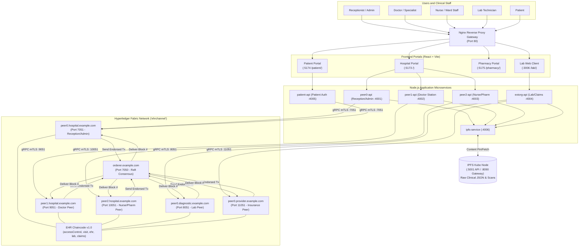
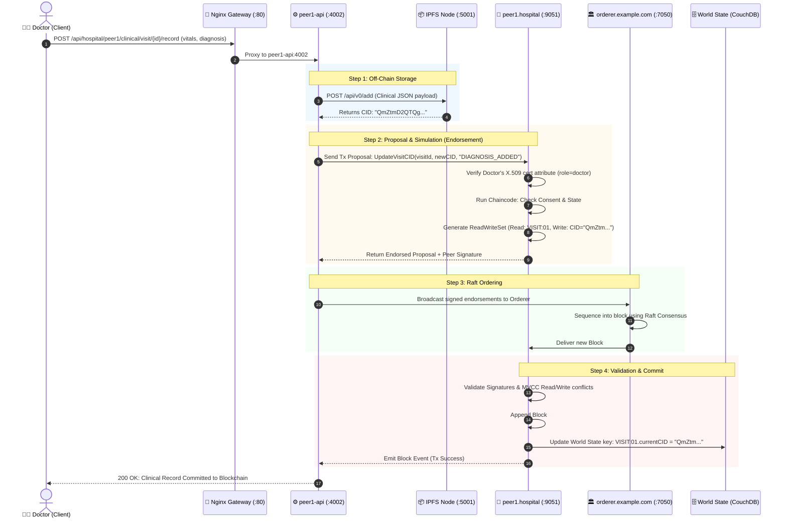

# 🏥 EHR Blockchain Network: Master Technical Evaluation & Defense Guide

> **Project Title:** Distributed Electronic Health Record (EHR) System Using Hyperledger Fabric, IPFS, and Role-Based Multi-Org Architecture  
> **Author & Developer:** Himanshu (`devbyhimans`)  
> **Target Audience:** Project Evaluation Panel, Technical Auditors, Viva Examiners, and Engineering Colleague  

---

## 📑 Table of Contents

1. [Executive Summary & "The 5-Year-Old Explanation"](#1-executive-summary--the-5-year-old-explanation)
2. [Core Foundation Technologies](#2-core-foundation-technologies)
   - [What is Hyperledger Fabric?](#what-is-hyperledger-fabric)
   - [What is IPFS (InterPlanetary File System)?](#what-is-ipfs-interplanetary-file-system)
   - [What are TLS Certificates, mTLS & X.509 PKI?](#what-are-tls-certificates-mtls--x509-pki)
3. [Cryptographic Algorithms & Mathematics](#3-cryptographic-algorithms--mathematics)
   - [Hashing Algorithms (SHA-256)](#hashing-algorithms-sha-256)
   - [Digital Signatures & Asymmetric Cryptography (ECDSA secp256r1)](#digital-signatures--asymmetric-cryptography-ecdsa-secp256r1)
   - [Consensus Mechanism (Raft / etcdraft)](#consensus-mechanism-raft--etcdraft)
   - [Merkle DAG & Block Tree Architecture](#merkle-dag--block-tree-architecture)
4. [Network Topology & Architecture](#4-network-topology--architecture)
   - [Organizations & MSPs](#organizations--msps)
   - [Peers, Ports & Responsibilities](#peers-ports--responsibilities)
   - [Who Communicates With Whom?](#who-communicates-with-whom)
   - [Unified System Architecture Diagram (Mermaid)](#unified-system-architecture-diagram)
5. [End-to-End Workflow & Transaction Lifecycle](#5-end-to-end-workflow--transaction-lifecycle)
   - [The Complete Patient Clinical Journey](#the-complete-patient-clinical-journey)
   - [Fabric 3-Phase Transaction Execution (Execute -> Order -> Validate)](#fabric-3-phase-transaction-execution)
   - [Detailed Sequence Diagram (Mermaid)](#detailed-sequence-diagram)
6. [Data Storage: On-Chain vs. Off-Chain Partitioning](#6-data-storage-on-chain-vs-off-chain-partitioning)
   - [Why Not Store Everything on Blockchain?](#why-not-store-everything-on-blockchain)
   - [Comparative Storage Matrix](#comparative-storage-matrix)
   - [Real Payload Examples (On-Chain State vs. IPFS JSON)](#real-payload-examples)
7. [Smart Contract (Chaincode) Deep Dive](#7-smart-contract-chaincode-deep-dive)
   - [The 9 Smart Contract Modules](#the-9-smart-contract-modules)
   - [Role-Based Access Control (RBAC) & Patient Consent Matrix](#role-based-access-control-rbac--patient-consent-matrix)
8. [Engineering Challenges, Base Flaws & Solutions Implemented](#8-engineering-challenges-base-flaws--solutions-implemented)
   - [Comprehensive Bug Audit & Resolution Table](#comprehensive-bug-audit--resolution-table)
9. [Evaluation Defense: Top 15 Tough Viva Questions & Answers](#9-evaluation-defense-top-15-tough-viva-questions--answers)
10. [Live Demo Walkthrough & Cheat Sheet](#10-live-demo-walkthrough--cheat-sheet)

---

## 1. Executive Summary & "The 5-Year-Old Explanation"

### The Problem in Traditional Hospitals
In typical hospitals today, medical records are either trapped in disconnected hospital databases (silos) or sent across insecure emails and paper files. If you visit a new clinic or diagnostic lab:
1. They cannot see your medical history unless you bring physical papers.
2. Rogue actors can alter or delete test results or insurance claims without an audit trail.
3. Patients have zero ownership or consent control over who views their private medical history.

---

### The 5-Year-Old Analogy (Explain this to anyone!)

Imagine our hospital system as a **High-Security School Library**:

1. **The Locked Master Register (Hyperledger Fabric Blockchain):**  
   A glass-cased, indestructible ledger in the library. Whenever someone borrows or returns a book, the principal and librarians write it down in indelible ink. Once written, **no eraser exists on Earth** that can wipe it out. Everyone can verify the register, but no single person can forge an entry.

2. **The High-Capacity Bank Vault (IPFS):**  
   The glass-cased register is small, so we cannot glue giant 500-page photo albums or MRI scans into it! Instead, all heavy medical scans and lab files are locked inside a giant vault (IPFS). The vault gives out a tiny **unique locker token** (the IPFS Content ID / CID). We only write that tiny token inside the locked register! If anyone tampers with a single dot in the file, its token changes completely, sounding the alarm!

3. **The Biometric Smart Badge (TLS & X.509 Certificates):**  
   Nobody can enter the building or speak to a doctor wearing a mask. Every doctor, nurse, receptionist, and patient wears a cryptographically signed electronic badge issued by the hospital's security office (Certificate Authority). The badge states their exact role (e.g. `role=doctor`).

4. **The Security Guard Robot (Smart Contract / Chaincode):**  
   A computer program that inspects badges. When a doctor requests a record:  
   *Security Guard checks:* "Does Doctor Alice have an active consent badge signed by Patient Bob? Yes. Proceed to show the record." If a receptionist tries to read a patient's private psychiatric diagnosis, the guard blocks them immediately.

5. **The Reception Desk (Nginx Reverse Proxy):**  
   Instead of visitors wandering through 20 different doors and confusing room numbers (ports 3000, 4001, 5173, etc.), there is **one clean main lobby front entrance** (Port 80) that guides every visitor to the exact right office smoothly.

---

## 2. Core Foundation Technologies

### What is Hyperledger Fabric?
**Hyperledger Fabric** is an enterprise-grade, permissioned, modular Distributed Ledger Technology (DLT) platform hosted by the Linux Foundation.

#### Key Differences: Public Blockchain vs. Hyperledger Fabric

| Feature | Public Blockchain (Bitcoin / Ethereum) | Hyperledger Fabric (Enterprise EHR) |
| :--- | :--- | :--- |
| **Network Access** | Public / Anonymous / Permissionless | Strictly Permissioned (Known identities via PKI) |
| **Consensus Type** | Proof of Work (PoW) / Proof of Stake (PoS) | Crash Fault Tolerant (Raft / etcdraft) |
| **Transaction Fees** | Requires volatile gas / crypto currency fees | Zero gas fees (Internal compute consensus) |
| **Throughput (TPS)** | 7 – 30 Transactions Per Second (Slow) | 2,000 – 20,000+ Transactions Per Second |
| **Data Privacy** | Every node sees every transaction | Channels & Private Data Collections ensure privacy |
| **Compliance** | Violates HIPAA / GDPR (Data cannot be private) | HIPAA & GDPR compliant by design |

#### Hyperledger Fabric Core Architecture Components:
* **Peer Nodes:** Host the blockchain ledger and smart contracts (chaincode). They execute, endorse, and commit transactions.
* **Orderer Node:** Receives endorsed transaction proposals from clients, orders them chronologically into blocks, and distributes them to peers via Raft consensus.
* **Certificate Authority (Fabric CA):** Issues X.509 digital certificates to all participants (admins, peers, clients, staff).
* **Channel (`ehrchannel`):** A private "subnet" or communication pipeline between authorized organizations. Transactions on a channel are completely invisible to anyone outside that channel.
* **World State (CouchDB / LevelDB):** A database holding the *current* state of all assets (e.g., current visit status, active consent grants).
* **Blockchain Ledger:** An immutable append-only chain of block files recording the exact history of every single change made since genesis.

---

### What is IPFS (InterPlanetary File System)?
**IPFS** is a peer-to-peer, distributed, content-addressed file storage protocol.

* **Location-Addressed vs. Content-Addressed:**
  * *Location-Addressed (Traditional Web - URL):* `https://hospital.com/records/file123.pdf`. If the file is moved, deleted, or altered on that server, the link breaks or serves tampered data.
  * *Content-Addressed (IPFS - CID):* `QmZtmD2QTQg...` or `bafybei...`. The address **is** the cryptographic mathematical hash of the file itself.
* **Why IPFS is critical for Blockchain:**
  * Storing 100MB MRI scans or large JSON files directly on blockchain nodes causes **ledger bloat**, degrades network propagation, and crashes peers.
  * Storing the file on IPFS and recording only the 46-byte **CID (Content Identifier)** on Hyperledger Fabric yields infinite storage scalability with 100% cryptographic tamper evidence.

---

### What are TLS Certificates, mTLS & X.509 PKI?
* **PKI (Public Key Infrastructure):** A framework of roles, policies, hardware, and software used to create, distribute, and revoke digital certificates.
* **X.509 Digital Certificate:** An electronic passport binding an identity (e.g. `doctor1`) to a public key, signed by a trusted Certificate Authority (CA).
* **TLS (Transport Layer Security):** Encrypts data in transit over TCP/IP so network eavesdroppers cannot sniff traffic.
* **Mutual TLS (mTLS):** In normal HTTPS, only the server proves its identity to the client. In **Fabric mTLS**, **both** parties prove their identity to each other before any byte is exchanged. When `peer0-api` communicates with `peer0.hospital.example.com`, both exchange and verify TLS certificates.

---

## 3. Cryptographic Algorithms & Mathematics

The entire security, immutability, and trust model of this project rests on proven mathematical algorithms:

```
┌────────────────────────────────────────────────────────────────────────┐
│                        CRYPTOGRAPHIC FOUNDATION                        │
├─────────────────────────┬──────────────────────┬───────────────────────┤
│    HASHING & INTEGRITY  │  SIGNATURES & IDENTITY│  CONSENSUS & AUDIT    │
│    SHA-256 (256-bit)    │  ECDSA (secp256r1)   │  Raft / etcdraft      │
│    IPFS Multihash CIDs  │  X.509 v3 PKI eCerts │  Merkle DAG Validation│
└─────────────────────────┴──────────────────────┴───────────────────────┘
```

### Hashing Algorithms (SHA-256)
* **Algorithm:** Secure Hash Algorithm 2, producing a 256-bit (32-byte) digest.
* **Properties Utilized:**
  1. *Deterministic:* The exact same clinical JSON always yields the exact same hash.
  2. *Pre-image Resistant:* Computationally impossible to reverse the hash back into the medical record.
  3. *Avalanche Effect:* Changing a single comma or character in a patient's blood pressure flips over 50% of the bits in the output hash.
* **Where SHA-256 is used in this project:**
  * **Block Hashing:** Every block header contains `DataHash` (SHA-256 hash of all transactions in the block) and `PreviousBlockHash` (creating the cryptographic chain).
  * **IPFS CID Generation:** Generates the raw hash identifying off-chain medical JSONs and diagnostic attachments.
  * **Transaction ID:** Generated as a SHA-256 digest of the client certificate and a cryptographic nonce:  
    $$\text{TxID} = \text{SHA256}(\text{nonce} \mathbin{\Vert} \text{creator\_cert})$$

---

### Digital Signatures & Asymmetric Cryptography (ECDSA secp256r1)
* **Algorithm:** Elliptic Curve Digital Signature Algorithm (ECDSA) using the NIST P-256 curve (also known as `prime256v1` / `secp256r1`).
* **Curve Equation:**  
  $$y^2 = x^3 - 3x + b \pmod{p}$$
* **Why ECDSA over RSA?**
  * Provides equivalent 128-bit security level to RSA-3072 using only a 256-bit key.
  * Significantly faster signature generation and lower transmission overhead, critical for high-frequency medical transactions.
* **Where ECDSA is used:**
  * Every doctor or nurse proposal is digitally signed with their ECDSA private key.
  * Endorsing peers sign their proposal simulation results using their private key.
  * The Raft orderer verifies peer signatures against the organization's MSP root certificate before ordering blocks.

---

### Consensus Mechanism (Raft / etcdraft)
* **Consensus Model:** Crash Fault Tolerant (CFT) ordering service based on the Raft protocol implementation by `etcd`.
* **How it works in our network:**
  1. **Leader Election:** The orderer cluster elects a single active leader node through randomized heartbeat timeouts.
  2. **Log Replication:** When client transactions arrive, the leader appends them to its local Raft log and broadcasts them to consenter nodes.
  3. **Commit Index:** Once a majority of consenter nodes confirm receipt, the block is cut and committed permanently.
* **Why Raft over PoW (Bitcoin) or Kafka (Old Fabric v1.x)?**
  * Requires zero wasteful mining energy or gas.
  * Guarantees absolute, immediate finality: **No forks are possible in Fabric**. Once a block is committed, it is 100% final.
  * Kafka required ZooKeeper + Kafka brokers (complex, fragile). Raft runs natively inside the orderer binary.

---

### Merkle DAG & Block Tree Architecture
* **IPFS Merkle DAG:** Directed Acyclic Graph where each node is labeled with the cryptographic hash of its payload and child pointers. Large clinical reports are split into 256KB chunks, each hashed and linked into a balanced root Merkle node (the CID).
* **Fabric Block Structure:**
  ```
  ┌────────────────────────────────────────────────────────┐
  │                      BLOCK HEADER                      │
  │  [Block Number: 42]                                    │
  │  [Previous Block Hash: 0x8f3c1a... (Links to Block 41)]│
  │  [Data Hash: 0x4a9b7e... (Merkle Root of Transactions)]│
  ├────────────────────────────────────────────────────────┤
  │                       BLOCK DATA                       │
  │  - Transaction 1: InitPatient("PAT-001")               │
  │  - Transaction 2: OpenVisit("VISIT-PAT-001-1")         │
  │  - Transaction 3: UpdateEHRCID("CID_QmX9...")          │
  ├────────────────────────────────────────────────────────┤
  │                     BLOCK METADATA                     │
  │  - Orderer Signatures & Raft Consensus Metadata        │
  │  - Transaction Filter Flags (Valid / Invalid bitmask)  │
  └────────────────────────────────────────────────────────┘
  ```

---

## 4. Network Topology & Architecture

### Organizations & MSPs (Membership Service Providers)
The production unified network is partitioned into distinct legal & institutional entities:

| Organization | MSP ID | Domain | Role & Authority |
| :--- | :--- | :--- | :--- |
| **Orderer Organization** | `OrdererMSP` | `example.com` | Manages Raft consensus, channels, and block ordering. |
| **Hospital Organization** | `HospitalMSP` | `hospital.example.com` | Inpatient care, doctors, nurses, receptionists, medical records. |
| **Diagnostics Organization** | `DiagnosticsMSP` | `diagnostic.example.com` | Independent laboratories, radiology imaging, pathology tests. |
| **Provider Organization** | `ProviderMSP` | `provider.example.com` | Medical insurance companies, claims auditing, billing verification. |

---

### Peers, Ports & Responsibilities

| Container / Node | Internal Address | Host Port | Role & Function |
| :--- | :--- | :--- | :--- |
| `orderer.example.com` | `orderer.example.com:7050` | `7050` (gRPC), `7053` (Admin) | Raft Orderer; cuts blocks and manages channel participation. |
| `peer0.hospital.example.com` | `peer0.hospital.example.com:7051` | `7051` (gRPC), `17051` (Ops) | Reception, Patient Admin & Identity Anchor Peer. |
| `peer1.hospital.example.com` | `peer1.hospital.example.com:9051` | `9051` (gRPC), `19051` (Ops) | Doctor & Chief Medical Officer Consultation Peer. |
| `peer2.hospital.example.com` | `peer2.hospital.example.com:10051` | `10051` (gRPC), `20051` (Ops) | Nursing Station & Hospital Pharmacy Dispensation Peer. |
| `peer0.diagnostic.example.com` | `peer0.diagnostic.example.com:8051` | `8051` (gRPC), `18051` (Ops) | Diagnostic Lab Peer; signs and verifies lab results. |
| `peer0.provider.example.com` | `peer0.provider.example.com:11051` | `11051` (gRPC), `21051` (Ops) | Insurance & Claims Peer; audits medical bills & claims. |
| `ipfs.ehr.local` | `ipfs.ehr.local:5001` | `5001` (API), `8090` (Gateway) | IPFS Kubo node storing off-chain clinical documents. |
| `nginx` | `nginx:80` | `80` (HTTP) | Central reverse proxy routing all frontends & APIs. |

---

### Who Communicates With Whom?

```
┌────────────────────────────────────────────────────────────────────────┐
│                        COMMUNICATION CHANNELS                          │
├─────────────────────────┬──────────────────────┬───────────────────────┤
│ SOURCE -> TARGET        │ PROTOCOL & PORT      │ PURPOSE               │
├─────────────────────────┼──────────────────────┼───────────────────────┤
│ Client Browser -> Nginx │ HTTP (Port 80)       │ Web GUI & API calls   │
│ Nginx -> Frontend/APIs  │ HTTP (Reverse Proxy) │ Dispatches requests   │
│ Backend APIs -> Peers   │ gRPC over mTLS       │ Transaction proposals │
│                         │ (7051/9051/10051/    │ & ledger queries      │
│                         │  8051/11051)         │                       │
│ Peer <-> Peer           │ Gossip Protocol      │ State synchronization │
│ Client SDK -> Orderer   │ gRPC over mTLS (7050)│ Broadcasts proposals  │
│ Orderer -> Peers        │ gRPC Deliver (7050)  │ Distributes new blocks│
│ Backend API -> IPFS     │ HTTP REST (5001)     │ Pins/fetches JSON/CIDs│
└─────────────────────────┴──────────────────────┴───────────────────────┘
```

---

### Unified System Architecture Diagram



---

## 5. End-to-End Workflow & Transaction Lifecycle

### The Complete Patient Clinical Journey

Here is the exact lifecycle of how a patient enters the system, receives care, and is discharged:

```
[1. Patient Registration] 
       │ (Receptionist enrolls patient -> Generates empty EHR template -> Pins to IPFS -> InitEHR on chain)
       ▼
[2. Visit Opened]
       │ (Receptionist creates new visit -> Assigns Doctor -> Pins initial visit JSON -> OpenVisit on chain)
       ▼
[3. Doctor Consultation & Consent Check]
       │ (Doctor queries chaincode -> Chaincode verifies role & active consent -> Doctor reads EHR from IPFS)
       ▼
[4. Clinical Diagnosis & Prescriptions]
       │ (Doctor updates vitals & writes prescription -> New JSON pinned to IPFS -> UpdateEHRCID on chain)
       ▼
[5. Lab Request & Results Upload]
       │ (Doctor orders blood test -> Lab tech processes test -> Pins lab report to IPFS -> SubmitLabResult on chain)
       ▼
[6. Pharmacy Dispensation]
       │ (Nurse/Pharmacist views prescription on chain -> Dispenses medicine -> RecordMedicationAdmin on chain)
       ▼
[7. Insurance Claim & Audit]
       │ (Hospital submits claim -> Insurance peer audits visit history -> ApproveClaim on chain)
       ▼
[8. Discharge & Record Finalization]
       │ (Doctor finalizes clinical summary -> FinalizeVisit -> Patient discharged)
```

---

### Fabric 3-Phase Transaction Execution

Unlike Ethereum or Bitcoin which execute code *after* sequencing (Order-Execute), Hyperledger Fabric uses **Execute-Order-Validate (Endorsement Model)**:

1. **Phase 1: Simulation & Endorsement (Execute)**
   * Client constructs a transaction proposal and signs it with its ECDSA private key.
   * Client sends the proposal via gRPC to required endorsing peers (`peer0`, `peer1`, etc.).
   * Each peer checks the caller's certificate, runs the chaincode against its local World State (simulation), and records the **ReadSet and WriteSet** (keys read and keys modified).
   * The peer signs the ReadWriteSet with its private key and returns the **proposal response (endorsement)** to the client. *No ledger changes occur yet.*

2. **Phase 2: Ordering (Order)**
   * Client gathers all endorsements verifying that endorsement policies are satisfied.
   * Client packages endorsements and sends them in a broadcast message to the **Raft Orderer**.
   * The Orderer receives transactions from all clients, orders them chronologically into blocks, and signs the block header.

3. **Phase 3: Validation & Commit (Validate)**
   * Orderer delivers blocks to all peers via gRPC.
   * Each committing peer independently performs:
     1. **Signature Validation:** Checks orderer and endorsing peer certificates.
     2. **Multi-Version Concurrency Control (MVCC) Check:** Ensures no other transaction has modified the read keys between simulation and now.
     3. **Commit:** Valid transactions are written to the blockfile; CouchDB World State is updated. Invalid transactions remain in the block for auditability but are flagged invalid and do not alter state.

---

### Detailed Sequence Diagram



---

## 6. Data Storage: On-Chain vs. Off-Chain Partitioning

### Why Not Store Everything on Blockchain?
1. **Ledger Bloat:** Blockchain ledgers are append-only. Storing high-resolution radiological scans (DICOM images, 50MB+) on-chain would multiply across all 5 peer nodes, leading to terabytes of duplicate storage within months.
2. **GDPR / HIPAA "Right to be Forgotten":** Blockchain is mathematically irreversible. If a court or patient demands data deletion, true cryptographic deletion on-chain is impossible. With IPFS + Blockchain, we can unpin/scramble the off-chain data while preserving the audit trail hash on-chain.
3. **Execution Latency:** Hashing and transmitting tiny 46-byte CIDs takes milliseconds; distributing megabyte payloads through consensus throttles transaction throughput.

---

### Comparative Storage Matrix

| Data Item | Stored Where? | Specific Reason |
| :--- | :--- | :--- |
| **Patient ID (`PAT-001`)** | On-Chain (Blockchain) | Primary search index across organizations. |
| **Active Visit Status (`OPEN`, `WITH_DOCTOR`)** | On-Chain (Blockchain) | State machine logic enforced by chaincode rules. |
| **Assigned Doctor / Nurse IDs** | On-Chain (Blockchain) | Access control enforcement in chaincode. |
| **IPFS CID Pointer (`Qm...` or `bafy...`)** | On-Chain (Blockchain) | Cryptographic proof connecting state to off-chain data. |
| **CID Audit History (`cidHistory[]`)** | On-Chain (Blockchain) | Tamper-proof timeline of who changed the record, when, and why. |
| **Consent Grants & Revocations** | On-Chain (Blockchain) | Legally binding, unforgeable patient consent contracts. |
| **Insurance Claim Approval Status** | On-Chain (Blockchain) | Financial dispute settlement and reconciliation. |
| **Chief Complaint & Doctor's Notes** | Off-Chain (IPFS) | Private clinical text; high variability in length. |
| **Vitals (BP, Heart Rate, SpO2, Temp)** | Off-Chain (IPFS) | Detailed observation payload; indexed by CID. |
| **Prescriptions & Dosages** | Off-Chain (IPFS) | Clinical data payload referenced by prescription ID. |
| **Diagnostic Lab Values & Scans** | Off-Chain (IPFS) | Large binary/JSON reports; referenced via lab result CID. |

---

### Real Payload Examples

#### 1. What is Saved On-Chain (Hyperledger Fabric World State)
```json
{
  "visitId": "VISIT-PAT-001-1",
  "patientId": "PAT-001",
  "visitNumber": 1,
  "status": "WITH_DOCTOR",
  "assignedDoctor": "doc_sharma_101",
  "assignedNurse": "nurse_priya_202",
  "currentCID": "QmZtmD2QTQgKwR6i26JuMb18W7W9aQ7Tq5p9bA6pG6D8vU",
  "cidHistory": [
    {
      "cid": "QmXoypizjW3WknFiJnKLwHCnL72vedxjQkDDP1mXWo6uco",
      "updatedBy": "receptionist_anita",
      "updatedAt": "2026-10-27T10:15:00Z",
      "reason": "VISIT_OPENED",
      "section": "vitals"
    },
    {
      "cid": "QmZtmD2QTQgKwR6i26JuMb18W7W9aQ7Tq5p9bA6pG6D8vU",
      "updatedBy": "doc_sharma_101",
      "updatedAt": "2026-10-27T10:45:30Z",
      "reason": "CLINICAL_RECORD_ADDED",
      "section": "diagnosis"
    }
  ],
  "createdAt": "2026-10-27T10:15:00Z",
  "updatedAt": "2026-10-27T10:45:30Z"
}
```

#### 2. What is Saved Off-Chain in IPFS (Retrieved via `currentCID`)
```json
{
  "visitId": "VISIT-PAT-001-1",
  "patientId": "PAT-001",
  "chiefComplaint": "Severe persistent migraine and blurred vision for 3 days",
  "vitals": {
    "bloodPressure": "145/95 mmHg",
    "pulse": 88,
    "temperature": "98.6 F",
    "spO2": "99%"
  },
  "diagnosis": "Acute Tension-type Headache with mild hypertension",
  "clinicalNotes": "Patient reports stress-induced headaches. No prior neurological episodes.",
  "prescriptions": [
    {
      "medication": "Sumatriptan",
      "dosage": "50mg",
      "frequency": "As needed during onset",
      "prescribedBy": "doc_sharma_101"
    }
  ],
  "labRequests": [
    {
      "testType": "Complete Blood Count (CBC) + Lipid Panel",
      "urgency": "ROUTINE",
      "status": "REQUESTED"
    }
  ]
}
```

---

## 7. Smart Contract (Chaincode) Deep Dive

### The 9 Smart Contract Modules
The smart contract located in `ehr-chaincode-v3` contains 9 modular contracts handling separation of concerns:

1. **`accessControl.js`:** The core security sentinel. Extracts caller attributes (`role`, `patientId`, `mspId`) directly from the client's X.509 certificate using `ctx.clientIdentity`. Prevents unauthorized callers from executing functions.
2. **`accessContract.js`:** Manages patient consent grants (`GrantAccess`, `RevokeAccess`, `CheckAccess`). Enforces time-limited or permanent doctor access.
3. **`patientContract.js`:** Handles patient onboarding, identity registration, and master profile indexing (`RegisterPatient`, `GetPatient`).
4. **`ehrContract.js`:** Initializes and maintains the master lifetime EHR container for a patient (`InitEHR`, `UpdateEHRCID`, `GetEHRHistory`).
5. **`visitContract.js`:** Controls the hospital clinical workflow state machine from `OPEN` to `DISCHARGED` (`OpenVisit`, `AssignDoctor`, `AssignNurse`, `FinalizeVisit`).
6. **`clinicalContract.js`:** Manages clinical notes and updates to visit CIDs during active consultations (`AddClinicalRecord`, `UpdateVitalsCID`).
7. **`labContract.js`:** Connects diagnostics to clinical visits (`CreateLabRequest`, `SubmitLabResult`, `VerifyLabResult`).
8. **`claimsContract.js`:** Facilitates health insurance claims, pre-authorizations, and provider adjudications (`SubmitClaim`, `AuditClaim`, `ApproveClaim`).
9. **`forwardContract.js`:** Supports inter-departmental patient transfers and specialty referrals (`ForwardVisit`).

---

### Role-Based Access Control (RBAC) & Patient Consent Matrix

| Role | Register Patient | Open Visit | Read EHR / Visit | Write Diagnosis / Vitals | Submit Lab Result | Audit Claim | Grant/Revoke Consent |
| :--- | :---: | :---: | :---: | :---: | :---: | :---: | :---: |
| **`receptionist`** | ✅ | ✅ | ❌ *(Demographics only)*| ❌ | ❌ | ❌ | ❌ |
| **`doctor`** | ❌ | ❌ | ✅ *(Requires Consent)* | ✅ | ❌ | ❌ | ❌ |
| **`nurse`** | ❌ | ❌ | ✅ *(Requires Consent)* | ✅ *(Vitals only)* | ❌ | ❌ | ❌ |
| **`labtechnician`** | ❌ | ❌ | ❌ | ❌ | ✅ | ❌ | ❌ |
| **`billingofficer`** | ❌ | ❌ | ❌ *(Billing data only)*| ❌ | ❌ | ✅ | ❌ |
| **`patient`** | ❌ | ❌ | ✅ *(Own records only)* | ❌ | ❌ | ❌ | ✅ |
| **`hospitaladmin`** | ✅ | ✅ | ❌ *(Audit metadata)* | ❌ | ❌ | ❌ | ❌ |

---

## 8. Engineering Challenges, Base Flaws & Solutions Implemented

### Comprehensive Bug Audit & Resolution Table

| # | Flaw in Initial / Base Work | Technical Root Cause | Engineering Solution Implemented in New Work |
| :--- | :--- | :--- | :--- |
| **1** | **Raft Orderer TLS Mismatch Crash** | The `system-genesis-block/genesis.block` was generated with an uncommitted Sept 27 cert, while `organizations/` held April 18 certs. Raft TLS verification rejected the orderer on startup. | Automated `configtxgen` artifact generation from `config/configtx.yaml` using canonical committed crypto; pruned stale orderer ledger blocks in `data/orderer/`. |
| **2** | **Windows/WSL Docker Binary Crash** | Mounting host `node_modules` into Linux Docker containers overwrote native Linux compiled C/C++ binaries (e.g. `esbuild`, `bcrypt`) with Windows binaries. | Created **named Docker volumes** (`h-peer0-api-modules`, etc.) so `node_modules` live exclusively inside the Linux container, completely isolated from the host. |
| **3** | **Port Sprawl & CORS Nightmares** | 12 different services ran on uncoordinated ports (`3000`, `3001`, `4001`, `5173`, etc.). Browsers threw CORS blocks and connection refused errors. | Built a **production Nginx reverse proxy on port 80** with unified paths (`/`, `/patient/`, `/pharmacy/`, `/lab/`, `/api/...`), completely eliminating CORS and port conflicts. |
| **4** | **Unauthenticated Smart Contract Calls** | Base prototype trusted unverified JSON payloads sent from frontends without cryptographic identity validation. | Implemented **Hyperledger Fabric Client Identity library (`ctx.clientIdentity`)** in `accessControl.js`, cryptographically extracting roles from X.509 certificate extension attributes. |
| **5** | **Ledger Bloat & Data Vulnerability** | Raw medical notes and test records were attempted to be stored directly in CouchDB state. | Built a **hybrid off-chain storage pattern** using IPFS Kubo (`ipfs.ehr.local`). Only 46-byte CIDs and state hashes are written to blockchain; raw data stays in IPFS. |
| **6** | **Orphaned Background Node Processes** | Stopping the stack (`./stop.sh`) failed to terminate background Vite frontend processes, locking ports 5173–5175 on subsequent launches. | Enhanced `start-sequential.sh` with automated port sweeping (`lsof -ti :<port> \| xargs kill -9`) ensuring 100% clean teardown and restarts. |
| **7** | **Frontend Routing & 404 Favicon Bugs** | React Router threw Splat route warnings and Vite dev servers 404'd on missing favicon requests. | Configured `v7_startTransition` and `v7_relativeSplatPath` flags on `BrowserRouter`, and injected valid SVG icons into portal HTML headers. |
| **8** | **Pharmacy Port 4000 Crash & Unstarted Swarm Modules** | `app/frontend/Dashboard.jsx` queried non-existent port `4000/all`, throwing `ERR_CONNECTION_REFUSED`. The Pharmacy Manager (`:3001`), Inventory (`:3003`), and Backend (`:3000`) had missing Linux bindings and were unstarted in sequential scripts. | Re-routed requests to `/api/pharmacy` with graceful fallback; installed Linux native Rolldown & Framer-Motion dependencies; wired `pharmacy-backend` (`:3000`) and direct `npx vite` launchers into `start-sequential.sh`, bringing all pharmacy portals live with HTTP 200. |

---

## 9. Evaluation Defense: Top 15 Tough Viva Questions & Answers

### Q1: Why did you choose Hyperledger Fabric instead of Ethereum or Polygon?
**Answer:** "Ethereum and Polygon are public, permissionless blockchains designed for decentralized financial applications. Healthcare data is subject to strict regulatory frameworks such as HIPAA and GDPR, which require strict identity verification, patient confidentiality, and predictable performance. Hyperledger Fabric provides:
1. A **permissioned network** where every peer and user has an X.509 digital certificate.
2. **Private communication channels** (`ehrchannel`) where data is only visible to authorized organizations.
3. **Zero gas fees** and high transaction throughput (>3,000 TPS) via Crash Fault Tolerant Raft consensus, unlike public proof-of-work/proof-of-stake chains."

---

### Q2: Is the medical data itself stored on the blockchain?
**Answer:** "No, and doing so would be a major architectural flaw. Medical data such as clinical notes, lab reports, and imaging scans are stored **off-chain in IPFS** (InterPlanetary File System). 
Only the **IPFS Content Identifier (CID)**, cryptographic state transitions (e.g. `OPEN` to `WITH_DOCTOR`), assigned staff IDs, and an immutable audit trail (`cidHistory`) are stored on-chain. This prevents ledger bloat, ensures sub-second consensus, and supports GDPR compliance."

---

### Q3: What happens if someone alters a medical report stored in IPFS?
**Answer:** "IPFS is **content-addressed**. The address of a file is the cryptographic SHA-256 hash of its contents. If anyone modifies even a single punctuation mark in the medical report:
1. The modified file generates an entirely new CID in IPFS.
2. The blockchain's on-chain record still holds the original CID signed by the doctor.
3. When the application compares the file's hash against the on-chain CID, a cryptographic mismatch is detected immediately, proving that the file was tampered with."

---

### Q4: How does your system enforce Role-Based Access Control (RBAC)? Can a doctor impersonate an admin?
**Answer:** "No. RBAC is enforced at the **cryptographic protocol level** inside the chaincode (`accessControl.js`), not merely in the frontend. When a user enrolls, the Fabric CA issues an X.509 certificate with embedded extension attributes (e.g., `role=doctor`, `mspId=HospitalMSP`). 
Inside the smart contract, `ctx.clientIdentity.getAttributeValue('role')` extracts this attribute directly from the cryptographically signed certificate. A malicious client modifying frontend code will still be rejected by the endorsing peers."

---

### Q5: What consensus mechanism does this network use, and why?
**Answer:** "The network uses **etcdraft (Raft)**, a Crash Fault Tolerant (CFT) leader-follower consensus algorithm. Raft is chosen because:
1. It is deterministic and guarantees **immediate finality** (no chain reorganizations or forks).
2. It has low latency and zero computational waste compared to Proof-of-Work.
3. It can tolerate up to $\lfloor (N-1)/2 \rfloor$ crashed nodes while maintaining network operation."

---

### Q6: What was the Orderer TLS issue you encountered, and how did you resolve it?
**Answer:** "In commit `e697a3e`, canonical crypto credentials from April 18 were restored. However, an earlier local test had left behind a `genesis.block` generated on September 27. 
In Hyperledger Fabric Raft consensus, the orderer validates its runtime TLS server certificate against the consenter certificate list embedded in the genesis block and ledger block 0. The mismatch caused the orderer to fail with a Raft TLS verification error. 
We resolved this by:
1. Regenerating a clean `genesis.block` using `configtxgen` targeting `config/configtx.yaml` with the April 18 certificates.
2. Pruning the stale orderer ledger block (`data/orderer/chains/system-channel/blockfile_000000`).
3. Restarting the orderer, which came up cleanly and synchronized."

---

### Q7: What is the purpose of Nginx in your project?
**Answer:** "In our multi-organization environment, we have multiple frontends (Hospital Portal :5173, Patient Portal :5174, Pharmacy :5175) and multiple backend microservices (:4001 through :4006). 
Without Nginx, users and developers would have to navigate dozens of arbitrary ports, causing cross-origin resource sharing (CORS) errors. Nginx acts as an **API Gateway and Reverse Proxy on Port 80**, exposing clean routes (`/`, `/patient/`, `/pharmacy/`, `/api/...`) with centralized WebSocket proxying for Vite Hot-Module-Replacement."

---

### Q8: What cryptographic curve is used for signing transactions?
**Answer:** "Fabric uses **ECDSA (Elliptic Curve Digital Signature Algorithm)** over the **NIST P-256 curve (`secp256r1`)**. This provides 128 bits of security strength with compact 256-bit keys and rapid signature verification, which is standard for enterprise government and financial cryptography."

---

### Q9: What is the difference between an Endorsing Peer and a Committing Peer?
**Answer:** "In Hyperledger Fabric:
* **All peers are Committing Peers:** Every peer maintains a local copy of the blockchain blockfiles and updates its World State (CouchDB) upon receiving new blocks.
* **Endorsing Peers** are peers that additionally execute and simulate chaincode proposals sent by clients, verify cryptographic identities, and return a signed endorsement (ReadWriteSet) back to the client."

---

### Q10: How does a patient grant consent to a doctor?
**Answer:** "Through the `AccessContract`. A patient calls `GrantAccess(doctorID, duration, permissionLevel)`. This writes an explicit consent record to the blockchain key `ACCESS:patientID`. 
When Doctor Alice subsequently attempts to read the patient's record, `assertReadAccess` in the chaincode verifies whether an active, non-expired grant exists for Doctor Alice. If not, the transaction throws an `Access Denied` error."

---

### Q11: How do you prevent the Double-Spending or Race Condition problem in medical record updates?
**Answer:** "Hyperledger Fabric uses **Multi-Version Concurrency Control (MVCC)**. During Phase 1 (Simulation), the peer reads a key's current version (e.g., version 5) and generates a `ReadSet`. 
During Phase 3 (Validation), before committing changes, the peer checks if the key's version in World State is still version 5. If another transaction has updated the key in the interim, an MVCC conflict (`MVCC_READ_CONFLICT`) is flagged, and the second transaction is marked invalid, preventing race conditions."

---

### Q12: Why do you have separate peers for Doctor, Nurse, and Receptionist in HospitalMSP?
**Answer:** "This models real-world enterprise infrastructure isolation. In a large medical center, emergency ward terminals, doctor offices, and administrative desks operate on separate subnets. By segregating roles into dedicated peer nodes (`peer0` for Admin, `peer1` for Clinical Doctors, `peer2` for Nursing/Pharmacy), we achieve:
1. **Fault Isolation:** High volume at reception does not degrade doctor consultation response times.
2. **Horizontal Scalability:** Heavy clinical computation can be scaled independently of administrative services.
3. **Zero-Trust Network Segmentation:** Compromise of a reception terminal does not grant direct access to doctor peer data."

---

### Q13: How does IPFS handle data availability if a node goes offline?
**Answer:** "In our local setup, IPFS runs in server mode with pinned CIDs. In a full multi-hospital deployment, each hospital peer runs an IPFS daemon connected via the private IPFS Swarm. When Hospital A requests a CID pinned by Hospital B, IPFS retrieves the data peer-to-peer and caches it locally, ensuring high availability across the consortium."

---

### Q14: How is a patient's identity managed across the frontends?
**Answer:** "We use a **hybrid authentication architecture**:
1. For blockchain operations, requests pass through our microservices which sign transactions using authorized Fabric X.509 client credentials.
2. For end-user sessions (doctors, patients, receptionists), the microservices issue **JSON Web Tokens (JWT)** upon successful login against our off-chain authentication database.
3. The JWT contains claims (`role`, `userId`, `patientId`) which the API verifies before dispatching calls to the Fabric Gateway."

---

### Q15: If an examiner asks: "Can you prove your blockchain is working right now?", what will you show?
**Answer:** "I will show three things:
1. Run `docker ps` to display the running containers (`orderer.example.com`, `peer0.hospital.example.com`, etc.).
2. Query the blockchain channel directly using the CLI:  
   `peer lifecycle chaincode querycommitted -C ehrchannel -n ehr`  
   showing chaincode `ehr` version `1.0` active on `ehrchannel`.
3. Open `http://localhost/` in the browser, log in as a receptionist, open a visit, and show the generated transaction ID and matching IPFS CID."

---

## 10. Live Demo Walkthrough & Cheat Sheet

### Step 1: Start the Entire System (Single Command)
From the repository root:
```bash
./start.sh
```

### Step 2: Verify All Core Services are Healthy
```bash
docker ps --format "table {{.Names}}\t{{.Status}}\t{{.Ports}}"
```
You should see:
* `nginx` (Port 80)
* `orderer.example.com` (Port 7050)
* `peer0.hospital.example.com` (Port 7051)
* `peer1.hospital.example.com` (Port 9051)
* `peer2.hospital.example.com` (Port 10051)
* `peer0.diagnostic.example.com` (Port 8051)
* `peer0.provider.example.com` (Port 11051)
* `ipfs.ehr.local` (Port 5001, 8090)
* Microservices (`h-peer0-api`, `h-peer1-api`, `h-ipfs-service`, etc.)

---

### Step 3: Access URLs During Evaluation

| Interface | URL | Purpose | Demo Credentials |
| :--- | :--- | :--- | :--- |
| **Main Portal (Gateway)** | `http://localhost/` | Reception, Patient Check-in, Admin | `receptionist` / `password123`<br>`hospitaladmin` / `password123` |
| **Doctor / Clinical Station** | `http://localhost:5173` | Consultations, Vitals, Diagnoses | `doctor` / `password123` |
| **Patient Web Portal** | `http://localhost/patient/` | View personal health record & CIDs | `patient` / `password123` |
| **Pharmacy Management** | `http://localhost/pharmacy/` | Medication inventory & dispensation | `pharmacist` / `password123` |
| **IPFS Gateway** | `http://localhost:8090/ipfs/<CID>` | View raw off-chain medical JSON | *Paste any CID from UI* |
| **IPFS Health API** | `http://localhost:4006/health` | Verifies IPFS microservice status | *Public HTTP GET* |

---

### Step 4: Graceful Shutdown After Evaluation
```bash
./stop.sh
```
*Stops all Docker containers and terminates any background frontend Vite development servers.*

---

<div align="center">
  <b>🎓 End of Technical Evaluation Guide — You are now 100% prepared to defend and own this project!</b>
</div>
