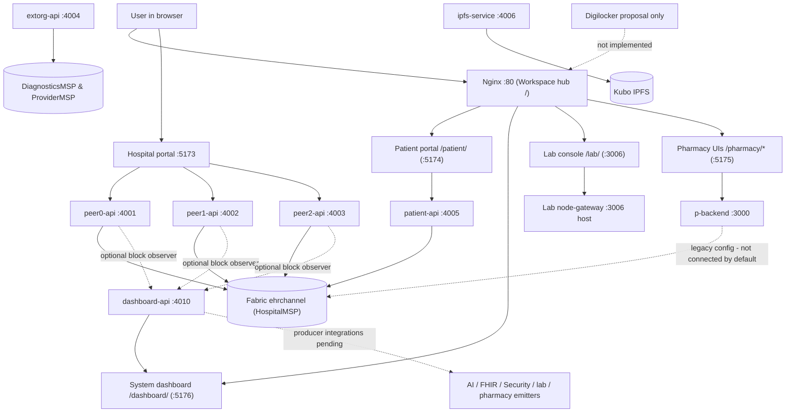

# EHR Blockchain Workspace

This repository contains a local academic/demo EHR workspace built around a Hyperledger Fabric network, Express APIs, React/Vite portals, an IPFS service, a lab gateway, and an optional read-only observability dashboard. It is a working project with unfinished integrations; it is not a production deployment or a legal/compliance certification.

FHIR R4, ABDM/ABHA, India DPDP Act 2023, HIPAA-style controls, and GDPR are design targets/reference points. Dashboard events are intended to contain zero patient-identifiable or clinical content. Digilocker remains proposed only.

## Start and stop

From the repository root:

```bash
./start.sh
```

The script checks that Docker and existing Fabric identity/CA material are present, starts the existing Fabric CAs and peer/orderer Compose stack, and then starts the app services in the root Compose file. It does **not** enroll identities, reset the channel or ledgers, delete Docker volumes, or deploy chaincode. The optional dashboard API and portal are started only when `dashboard-api/.env` exists; configuration values belong in that local ignored file, never in Git or chat.

Stop without deleting persistent data:

```bash
./stop.sh
```

`setup.sh` checks prerequisites, pulls selected images, and installs a subset of Node dependencies. It does not initialize Fabric identity material. `start-sequential.sh` is a legacy host-process launcher; the supported all-in-one local flow is `./start.sh`.

## Entry points

| Service | URL | Notes |
|---|---|---|
| Workspace hub | [http://localhost/](http://localhost/) | Links to the available portals and checks service reachability. |
| Hospital staff portal | [http://localhost:5173/](http://localhost:5173/) | React/Vite dev server; API requests use the peer APIs through configured proxy targets. |
| Patient portal | [http://localhost/patient/](http://localhost/patient/) or port `5174` | Hospital patient portal. |
| Dashboard | [http://localhost/dashboard/](http://localhost/dashboard/) | Optional Compose profile; needs dashboard `.env` and valid authentication configuration. |
| Pharmacy main portal | [http://localhost/pharmacy/](http://localhost/pharmacy/) or port `5175` | Separate UI from the pharmacy manager, employee, inventory, billing, and patient apps. |
| Pharmacy manager / employee / inventory / billing | `/pharmacy/manager/`, `/pharmacy/employee/`, `/pharmacy/inventory/`, `/pharmacy/billing/` | Separate Vite apps on host ports `3001`, `3002`, `3003`, `3005`. |
| Lab console | [http://localhost/lab/](http://localhost/lab/) | Lab gateway and static console; the standalone lab Fabric network is not started by the root script. |

The pharmacy patient app is a status-only portal. It does not expose patient records because the pharmacy API has no patient-authenticated session flow; a reachable API is not proof of patient authorization or a connected ledger. The other pharmacy APIs and UIs can run while ledger-backed operations remain unavailable. Their existing Fabric profile targets legacy `Org1MSP`/`mychannel` configuration and does not match the current hospital network.

The standalone Digilocker proposal has no runnable service in this workspace.

## Architecture (as currently wired)



The current Fabric topology is configured through the Fabric network files. The local default channel is `ehrchannel`; the organizations are `HospitalMSP`, `DiagnosticsMSP`, and `ProviderMSP`. Dashboard topology values live in its configuration and can be changed there. Some legacy service code still contains fixed network assumptions; the current dashboard topology uses configuration rather than a peer IP list.

## Service map

| Component | Host port / route | Current role |
|---|---:|---|
| `h-peer0-api` | `4001`, `/api/hospital/peer0/` | Reception/admin API and hospital login endpoint. |
| `h-peer1-api` | `4002`, `/api/hospital/peer1/` | Doctor API. |
| `h-peer2-api` | `4003`, `/api/hospital/peer2/` | Nurse/pharmacist/medical-record API. |
| `h-extorg-api` | `4004`, `/api/hospital/extorg/` | Diagnostics/provider API. |
| `h-patient-api` | `4005`, `/api/hospital/patient/` | Patient API. |
| `h-ipfs-service` | `4006`, `/api/hospital/ipfs/` | IPFS bridge API. |
| `h-dashboard-api` | `4010` (loopback host binding), `/api/dashboard/` | Optional event store, collector, realtime streams, and role-filtered aggregation API. |
| `h-dashboard-portal` | `5176` (loopback host binding), `/dashboard/` | Optional role-aware dashboard UI. |
| `p-backend` | `3000`, `/api/pharmacy/` | Separate pharmacy API; current network identity/config is a known integration blocker. |
| `l-node-gateway` | `3006` host, `/lab/` | Lab API and static console. |

Use `docker compose ps` to see container state and `docker compose logs --tail=100 <service>` to inspect one service. A responding HTTP endpoint means only that service responded; it does not prove Fabric, IPFS, or another organization is connected.

## Dashboard status and safety

The dashboard API and portal are implemented as an optional module. The API includes HS256 JWT verification, a config-based default-deny role map, zero-PHI envelope validation, an append-only NDJSON event cache, a committed-block collector, bounded health polling, `POST /internal/events`, stream tickets, WebSocket/SSE routes, and REST aggregation/trace endpoints. Producer integrations for AI, history, governance, FHIR, security, lab, and pharmacy remain unconnected unless an owner supplies an emitter. The `history-agent` is a logical registry entry marked not connected.

The event store is a local operational cache, not the authoritative Fabric ledger or a tamper-proof compliance audit. The dashboard does not write to Fabric. It has no Docker socket access and does not manage containers. CPU, memory, disk, and IPFS storage metrics are deferred. Real event data requires configured observer credentials and actual producer integrations; synthetic mock events are separate and explicitly marked.

The dashboard login uses the hospital peer0 login route. Configure its JWT verification secret(s) in the dashboard's own local ignored `.env`; never copy another service's `.env` or put credentials in this repository. `DASHBOARD_JWT_SECRETS` can contain keys in order; lab/provider tokens require their signing key to be configured separately. The stream-ticket query parameter is one-use and short-lived; never log ticket URLs.

See [dashboard API README](orgs/hospital/EHR_hospitalOrg-main/ehr-backend-v3/dashboard-api/README.md), [dashboard handoff](docs/dashboard/PROJECT_HANDOFF.md), [dependencies](docs/dashboard/DEPENDENCIES.md), and [testing notes](docs/dashboard/TESTING.md).

## Pharmacy and lab boundaries

The pharmacy apps are intentionally kept separate. The root startup launches the backend and the manager, employee, inventory, billing, main, and patient frontends. The patient portal is a status-only shell until the backend supports verified patient authentication and patient-scoped access. Pharmacy screens display unavailable states instead of inventing live patient, inventory, or ledger data. A working pharmacy ledger integration requires its team to align a valid connection profile, wallet/crypto material, channel, and deployed contract with the current network.

The lab console is available as a UI/gateway; that does not mean the separate lab Fabric network, AI provider, or IPFS path is connected. The UI hides fallback records when live peer metadata is unavailable.

## Repository map

```text
orgs/hospital/EHR_hospitalOrg-main/
  ehr-network/                 Fabric network scripts/configuration
  ehr-backend-v3/              Hospital APIs, IPFS service, dashboard API
  ehr-frontend-v2/              Hospital, patient, and dashboard portals
  ehr-chaincode-v3/             Eight Fabric contracts
orgs/pharmacy/fabric-network-swarm/
  app/backend/                  Pharmacy API
  app/{manager,employee,inventory,billing,frontend}/ Separate UIs
  app/patient/                  Incomplete UI; src/ is absent
orgs/lab/EHR-LABORG-main/       Lab gateway/UI and standalone network assets
docs/                           Architecture, setup, dashboard, and audit notes
nginx/hub/                      Single-entry service hub
```

## Documentation

- [Current architecture diagrams](docs/architecture.md)
- [System overview](docs/system-overview.md)
- [Setup guide](docs/setup-guide.md)
- [Dashboard project handoff](docs/dashboard/PROJECT_HANDOFF.md)
- [Phase 0 dashboard discovery (historical baseline)](docs/audit/DASHBOARD_DISCOVERY.md)
- [Hospital multi-system guide](orgs/hospital/EHR_hospitalOrg-main/README.md) — separate legacy/distributed workflow; the root `./start.sh` flow above is the local workspace default.

## Safety and data

Use synthetic test accounts and data locally. Do not commit `.env` files, wallets, TLS private keys, patient data, or dashboard event-store data. The portal theme (light/dark) is shared across local interfaces using the `ehr_appearance` preference; theme state is presentation-only and grants no access.
