# Electronic Health Record (EHR) Blockchain Consortium
## Multi-Organization Healthcare Ledger with Zero-PHI IPFS Off-Chain Storage, 13 Chaincode Contracts, Autonomous Clinical AI Decision Support, and Real-Time Observability

[](https://www.hyperledger.org/projects/fabric)
[](https://ipfs.tech/)
[](https://fastapi.tiangolo.com/)
[](https://react.dev/)
[](https://www.docker.com/)
[](https://nginx.org/)
[](LICENSE)

---

### 👨‍💻 Project Repository & Academic Credentials

* **Repository URL:** [https://github.com/devbyhimans/Electronic_Health_Record_Blockchain.git](https://github.com/devbyhimans/Electronic_Health_Record_Blockchain.git)
* **Lead System Architect & Core Orchestrator:** **Himanshu**
* **Roll Number:** **24MCF1R16**
* **Department:** Master of Computer Applications (MCA 3rd Year)
* **Institution:** National Institute of Technology (NIT), Warangal
* **Pillar Focus:** Real-Time Blockchain Event Architecture, Master Container Orchestration (`./start.sh` / `./stop.sh`), Nginx API Gateway, Unified Pharmacy Suite, and Zero-PHI Data Streaming Pipeline.

---

## 📖 Executive Summary

The **CareGrid EHR Consortium** is a production-grade, privacy-first healthcare blockchain ecosystem engineered on **Hyperledger Fabric 2.5 LTS**. It federates three autonomous healthcare organizations (**HospitalMSP**, **DiagnosticsMSP**, and **ProviderMSP**) alongside an independent Raft consensus ordering cluster (**OrdererMSP**). The consortium operates a **Dual-Channel Blockchain Architecture**: a tripartite channel (`ehrchannel`) for clinical encounters, laboratory diagnostics, and medication dispensing, and a dedicated, cryptographically isolated channel (`insurancechannel`) strictly between the hospital and insurance provider for zero-PHI claims adjudication, patient co-pay calculations, and automated digital settlement.

To guarantee strict compliance with national and international healthcare data privacy mandates (including the **India Digital Personal Data Protection (DPDP) Act 2023**, **Ayushman Bharat Digital Mission (ABDM/ABHA)**, **HIPAA Security Rules**, and **GDPR**), CareGrid adopts a rigorous **Zero-PHI (Zero Protected Health Information) on-chain architecture**:
1. **On-Chain Ledger:** Hyperledger Fabric stores only immutable Decentralized Identifiers (W3C DIDs: `did:ehr:<hash>`), cryptographic hashes (SHA-256 digests), zero-knowledge consent grants, access audit trails, and IPFS Content Identifiers (CIDs).
2. **Off-Chain Storage:** Bulky clinical narratives, diagnostic scan blobs, itemized prescription sheets, and patient identity profiles are sealed with **AES-256-GCM envelope encryption** and content-addressed inside an immutable **Kubo IPFS** cluster.
3. **Clinical Intelligence:** Autonomous clinical decision support agents (**FastAPI** with PubMed RAG and **Google Gemini** symptom triage) assist medical practitioners during consultation without exposing unencrypted health data to public ledgers.
4. **Real-Time Observability:** A high-frequency WebSocket and Server-Sent Events (SSE) event pipeline streams block commit telemetry, peer latency metrics, and clinical agent traces to an Obsidian Glass management console.

---

## ⚡ Quick Start & Verification (WSL2 / Ubuntu Linux)

The entire ecosystem (5 Fabric peers, Raft orderer, 4 CAs, Kubo IPFS, 8 REST gateways, 1 FastAPI AI agent, 4 React portals, and Nginx proxy) boots deterministically via a single orchestration command.

### System Requirements
* **Operating System:** Ubuntu 22.04 LTS / 24.04 LTS (Native or WSL2 on Windows 10/11)
* **Hardware:** 8 GB RAM minimum (16 GB recommended), 4 CPU cores, 25 GB free disk space
* **Installed Runtimes:** Docker Engine with Compose V2 plugin, Node.js 20+, `curl`, and `jq`

### One-Command Setup and Startup

```bash
# 1. Clone the repository
git clone https://github.com/devbyhimans/Electronic_Health_Record_Blockchain.git
cd Electronic_Health_Record_Blockchain

# 2. Automated dependency initialization (first run only)
./setup.sh

# 3. Launch all network nodes, chaincode, gateways, and portals
./start.sh
```

`./start.sh` dynamically checks peer certificates, initializes Fabric identities, registers chaincode definition sequence matching source code, boots all 17 microservices, and waits until every health check returns `UP (200 OK)`.

```bash
# Verify health of all services across the consortium
curl -s http://localhost/health | jq .

# Stop the entire platform (preserving all ledger blocks and IPFS state)
./stop.sh

# Complete teardown and clean factory reset (erases docker volumes and ledgers)
./stop.sh --reset --yes
```

---

## 🌐 Unified Service Directory & Access Endpoints

All services and frontends are unified under an **Nginx Ingress Reverse Proxy** on Port 80, eliminating CORS issues and exposing clear, role-segregated entry points:

| Service / Portal | Host Port | Ingress Route (Port 80) | Technology Stack | Core Responsibilities |
|:---|:---:|:---|:---|:---|
| **Consortium Showcase Hub** | `80` | `http://localhost/` | Nginx Alpine / HTML5 | Central consortium dashboard, system telemetry cards, quick links |
| **Hospital Staff Portal** | `5173` | `http://localhost:5173/` | React 18, Vite, Tailwind | Receptionist, Doctor, Nurse, Medical Records, Hospital Admin |
| **Patient Self-Service Portal** | `5174` | `http://localhost:5174/` | React 18, Vite, Tailwind | Patient timeline, consent manager, Master EHR records |
| **Unified Pharmacy Suite** | `5175` | `http://localhost:5175/` | React 18, Vite, Tailwind | Zero-trust RBAC: Manager, Pharmacist, Inventory, Billing, Patient |
| **Observatory Dashboard** | `5176` | `http://localhost/dashboard/` | React 18, Vite, D3.js | Group 1 Real-time block explorer, peer metrics, alert monitor |
| **Lab Diagnostics Deck** | `3006` | `http://localhost/lab/` | Node.js Express, EJS/HTML5 | Standalone lab workstation: sample intake, report entry, VCAP |
| **Insurance & TPA Claims Deck** | `4004` | `http://localhost/insurance/` | Vanilla JS, Glassmorphism, Fabric Gateway | Dedicated claims portal: role separation (Billing Officer, Claims Auditor, Insurance Officer), selective disclosure IPFS packet inspector, cryptographic provenance stepper, digital EOB certificate |
| **Clinical AI Agent** | `8000` | `http://localhost/ai-agent/docs` | Python 3.11, FastAPI, Swagger | Medical RAG, PubMed literature citation, vital trend anomaly analysis |
| **Reception & Admin API** | `4001` | `http://localhost:4001/` | Node.js Express, Fabric Gateway | Patient registration, visit creation, doctor queue assignment |
| **Doctor & Clinical API** | `4002` | `http://localhost:4002/` | Node.js Express, Fabric Gateway | Diagnosis notes, ICD-10 disease coding, lab orders, prescriptions |
| **Nurse & Pharmacy API** | `4003` | `http://localhost:4003/` | Node.js Express, Fabric Gateway | Vitals logging, nurse care notes, hospital medication dispensing |
| **Diagnostics & Claims API** | `4004` | `http://localhost:4004/` (API: `/api/insurance/`) | Node.js Express, Dual-Channel Fabric Gateway | Multi-channel gateway: lab results on `ehrchannel`, claims lifecycle on `insurancechannel` |
| **Patient Gateway API** | `4005` | `http://localhost:4005/` | Node.js Express, Fabric Gateway | Patient authentication, consent grants, longitudinal EHR timeline |
| **IPFS Bridge Service** | `4006` | `http://localhost:4006/` | Node.js Express, IPFS HTTP Client | AES-256-GCM envelope encryption, multipart upload, CID multihash |
| **DigiLocker Vault Service** | `4007` | `http://localhost:4007/` | Node.js Express, PDFKit, Crypto | Government clinical PDF generation, digital signing, vault anchoring |
| **Observatory Event API** | `4010` | `http://localhost/api/dashboard/`| Node.js Express, SQLite, WS | Fabric block commit collector, Zero-PHI normalizer, WebSocket/SSE |
| **Pharmacy Core Backend** | `3000` | `http://localhost:3000/` | Node.js Express, Persistent Store | Inventory stock deduction, itemized bills, IPFS receipt pinning |
| **Kubo IPFS Daemon** | `5001 / 8090` | `http://localhost:5001/webui` | Kubo IPFS Go Daemon | Decentralized content-addressed storage (API :5001, Gateway :8090) |

---

## 🔑 Demo Access Credentials & Role Matrix

The platform enforces Role-Based Access Control (RBAC) backed by digital X.509 certificate identities and HS256 JWT tokens:

| Portal | Username | Password | Role | Permitted Actions & Ledger Scope |
|:---|:---|:---|:---|:---|
| **Hospital Staff** | `receptionist` | `recpw` | Receptionist | Register patient profiles (`PatientContract`), open visits (`VisitContract`), assign doctor |
| **Hospital Staff** | `doctor` | `docpw` | Doctor | Consultation notes, confirm ICD-10 codes, order lab tests, prescribe medication |
| **Hospital Staff** | `nurse` | `nursepw` | Nurse | Record physiological vitals ($SpO_2$, BP, Pulse, Temp), enter nursing care notes |
| **Hospital Staff** | `medrecordofficer` | `medpw` | Records Officer | Finalize discharged encounters, verify comprehensive record integrity |
| **Hospital Staff** | `hospitaladmin` | `hadminpw` | Hospital Admin | Consortium governance, audit logs, authorized dashboard administrator |
| **Lab Deck** | `labreceptionist` | `recpw` | Lab Receptionist | Receive patient specimens, acknowledge lab test requests (`LabContract`) |
| **Lab Deck** | `labtechnician` | `recpw` | Lab Technician | Ingest analyzer biomarker readings (Hemoglobin, WBC, Platelets, Glucose) |
| **Lab Deck** | `labsupervisor` | `recpw` | Lab Supervisor | Verify SHA-256 resultsHash against raw data, cryptographic co-signature |
| **Insurance Deck** | `billingofficer` | `recpw` | Billing Officer | Hospital billing liaison: generates selective disclosure IPFS packet (filtering sensitive PHI) & submits claim (`ClaimsContract:SubmitClaim`) |
| **Insurance Deck** | `claimsauditor` | `recpw` | Claims Auditor | Provider auditor: reviews medical necessity against ICD-10 diagnostic & CPT procedure codes (`ClaimsContract:AuditClaim`) |
| **Insurance Deck** | `insuranceofficer` | `recpw` | Insurance Officer | Senior adjudicator: verifies policy limits, calculates deductible/co-pay (e.g. 15% co-pay / 85% insurer split), authorizes payout, emits `ClaimSettled` (`ClaimsContract:ProcessClaim`) |
| **Insurance Deck** | `provideradmin` | `recpw` | Provider Admin | Insurance organization administrator: governance, audit logs, provider key management |
| **Pharmacy Suite** | `pharmacist` | `pharmpw` | Pharmacist | Verify hospital prescription on-chain, dispense medication (`ClinicalContract`) |
| **Pharmacy Suite** | `inventory_mgr_01` | `invpw` | Inventory Manager | Medicine catalog management, stock replenishment, unit pricing |
| **Pharmacy Suite** | `billing_clerk_01` | `billpw` | Billing Clerk | Outpatient billing packages, IPFS invoice generation, auto-inventory deduction |
| **Pharmacy Suite** | `pharmacy_mgr` | `adminpw` | Pharmacy Manager | Pharmacy staff oversight, financial bill audit trail, inventory health inspection |
| **Patient Portal** | Registered Patient ID | User Secret | Patient | Authenticate via registered phone, manage consent grants, view DigiLocker Vault |

---

## 🏛️ System Architecture in Four Tiers

The CareGrid platform is strictly structured across **four architectural tiers**, reading top-to-bottom. Each tier communicates exclusively with the tier directly beneath it, guaranteeing that **personally identifiable clinical information (PHI) never reaches Tier 3**:

```mermaid
flowchart TD
    subgraph Tier1 ["1. PRESENTATION TIER (React 18 + Vite Portals & Enterprise Decks)"]
        HUB["Showcase Hub (Port :80)<br/>Consortium Ingress & Telemetry"]
        HOSP_PORTAL["Hospital Staff Portal (Port :5173)<br/>Reception, Doctor, Nurse, Lab, Admin"]
        PAT_PORTAL["Patient Self-Service Portal (Port :5174)<br/>Timeline, Consent & DigiLocker Vault"]
        PHARM_PORTAL["Unified Pharmacy Suite (Port :5175)<br/>Manager, Pharmacist, Inventory, Billing"]
        DASH_PORTAL["Observatory Dashboard (Port :5176 / /dashboard/)<br/>Real-Time Block Inspector & Alerts"]
        INS_PORTAL["Insurance & TPA Claims Deck (Port :4004 / /insurance/)<br/>Billing, Auditor & Adjudication Workspaces"]
    end

    subgraph Tier2 ["2. APPLICATION & GATEWAY TIER (Node.js Express & Python FastAPI)"]
        P0_API["peer0-api (Port :4001)<br/>Reception & Admin Gateway"]
        P1_API["peer1-api (Port :4002)<br/>Doctor & MedRecords Gateway"]
        P2_API["peer2-api (Port :4003)<br/>Nurse & Pharmacy Gateway"]
        EXT_API["extorg-api (Port :4004)<br/>Diagnostics & Dual-Channel Claims Gateway"]
        PAT_API["patient-api (Port :4005)<br/>Patient Account & Consent Gateway"]
        IPFS_SVC["ipfs-service (Port :4006)<br/>AES-256-GCM Encryption Bridge"]
        DL_SVC["digilocker-service (Port :4007)<br/>Clinical PDF Generator & Vault"]
        DASH_API["dashboard-api (Port :4010)<br/>Block Collector & Normalizer"]
        AI_SVC["clinical-ai-agent (Port :8000)<br/>FastAPI Medical RAG & Anomaly Agent"]
        L_GATE["l-node-gateway (Port :3006)<br/>Multi-Agent Orchestrator & VCAP"]
        P_BACK["p-backend (Port :3000)<br/>Pharmacy Store & Inventory Engine"]
    end

    subgraph Tier3 ["3. BLOCKCHAIN CONSENSUS TIER (Hyperledger Fabric 2.5 LTS - Dual-Channel Topology)"]
        subgraph ChannelEHR ["Clinical Channel: ehrchannel (HospitalMSP + DiagnosticsMSP + ProviderMSP)"]
            H_PEER0["peer0.hospital:7051<br/>Reception & Admin"]
            H_PEER1["peer1.hospital:9051<br/>Doctor Node"]
            H_PEER2["peer2.hospital:10051<br/>Nurse & Pharmacy"]
            D_PEER0["peer0.diagnostic:8051<br/>Lab Diagnostics Peer"]
            PR_PEER0_EHR["peer0.provider:11051<br/>Provider Cross-Org Peer"]
        end

        subgraph ChannelINS ["Settlement Channel: insurancechannel (HospitalMSP + ProviderMSP — DiagnosticsMSP Excluded)"]
            H_PEERS_INS["Hospital Peers<br/>(peer0, peer1, peer2)"]
            PR_PEER0_INS["peer0.provider:11051<br/>Claims Adjudication Peer"]
        end

        subgraph OrdererMSP ["Consensus Cluster (OrdererMSP)"]
            ORDERER["orderer.example.com:7050<br/>Raft CFT Consensus Leader"]
        end

        subgraph ChaincodeEngine ["Chaincode Package ehr (v3.1 on ehrchannel, v1.1 on insurancechannel)"]
            CONTRACTS["13 Domain Contracts: PatientContract, VisitContract, ForwardContract,<br/>ClinicalContract, LabContract, ClaimsContract, EhrContract, AccessContract,<br/>FhirContract, DigiLockerContract, DidContract, CodeContract, StatsContract"]
        end
    end

    subgraph Tier4 ["4. OFF-CHAIN STORAGE & PERSISTENCE TIER (Zero-PHI Compliant)"]
        KUBO_IPFS["Kubo IPFS Daemon (ipfs.ehr.local :5001 / :8090)<br/>Content-Addressed Encrypted Storage (CIDs)"]
        SELECTIVE_IPFS["Selective Disclosure Claim Packets<br/>Filtered Non-PHI IPFS Packets (CIDs)"]
        SQLITE_DB["SQLite Local Databases<br/>CA Keystores & Dashboard Read Cache"]
        PHARM_JSON["Pharmacy JSON Store (store.js)<br/>Local Stock Inventory & Outpatient Bills"]
    end

    %% Ingress and Connections
    HUB --> HOSP_PORTAL & PAT_PORTAL & PHARM_PORTAL & DASH_PORTAL & INS_PORTAL
    HOSP_PORTAL -->|"HTTPS + Staff JWT"| P0_API & P1_API & P2_API
    PAT_PORTAL -->|"HTTPS + Patient JWT"| PAT_API & DL_SVC
    PHARM_PORTAL -->|"HTTPS + Pharmacy JWT"| P_BACK & P2_API
    DASH_PORTAL -->|"WebSocket / REST"| DASH_API
    INS_PORTAL -->|"HTTPS + Provider JWT"| EXT_API
    HOSP_PORTAL -.->|"REST /ai-agent/"| AI_SVC

    %% Tier 2 to Tier 4
    P0_API & P1_API & DL_SVC & P_BACK -->|"Payloads for Encryption"| IPFS_SVC
    IPFS_SVC -->|"Encrypted Multihash CIDs"| KUBO_IPFS
    EXT_API -->|"Selective Non-PHI Packets"| SELECTIVE_IPFS
    SELECTIVE_IPFS --> KUBO_IPFS
    P_BACK -->|"Read/Write Local Stock"| PHARM_JSON
    DASH_API -->|"Operational Read Cache"| SQLITE_DB

    %% Tier 2 to Tier 3 (gRPC Fabric Gateway)
    P0_API -->|"gRPC Endorsement"| H_PEER0
    P1_API -->|"gRPC Endorsement"| H_PEER1
    P2_API -->|"gRPC Endorsement"| H_PEER2
    EXT_API -->|"ehrchannel Endorsement"| D_PEER0 & PR_PEER0_EHR
    EXT_API -->|"insurancechannel Endorsement"| H_PEERS_INS & PR_PEER0_INS
    PAT_API -->|"gRPC Read"| H_PEER0 & H_PEER1
    DL_SVC -->|"Anchor Document"| H_PEER0
    L_GATE -->|"Submit Diagnostic Report"| D_PEER0

    %% Smart Contracts Execution
    H_PEER0 & H_PEER1 & H_PEER2 & D_PEER0 & PR_PEER0_EHR & PR_PEER0_INS --> CONTRACTS
    H_PEER0 & H_PEER1 & H_PEER2 & D_PEER0 & PR_PEER0_EHR & PR_PEER0_INS -->|"Orderer Block Cut"| ORDERER
    H_PEER0 -.->|"Committed Block Events"| DASH_API
```



---

## 🔄 End-to-End Clinical & Data Flow Diagram (DFD)

The following labelled Data Flow Diagram illustrates the full clinical lifecycle: from patient intake and Gemini AI symptom triage, to doctor consultation, laboratory analysis, supervisor signing, pharmacy dispensing, real-time telemetry extraction, and DigiLocker export:

```mermaid
flowchart TD
    subgraph S1 ["Stage 1: Patient Registration & DID Generation"]
        A1["Patient arrives at Reception"] --> A2["Receptionist inputs Demographics & Symptoms (:5173)"]
        A2 -->|"POST /patients"| A3["peer0-api Gateway (:4001)"]
        A3 -->|"Query Symptom Model"| A4["Gemini AI Triage (gemini-3.8-flash)<br/>Provisional ICD-10 suggestions"]
        A3 -->|"Encrypt PHI with AES-256-GCM"| A5["ipfs-service (:4006)"]
        A5 -->|"Store Encrypted Payload"| A6["Kubo IPFS Node<br/>Returns CID multihash"]
        A3 -->|"Submit Zero-PHI Anchor<br/>patientIdHash, DID, CID"| A7["Fabric PatientContract<br/>Registers did:ehr:hash on-chain"]
    end

    subgraph S2 ["Stage 2: Doctor Consultation & Clinical Decision Support"]
        B1["Doctor opens Hospital Portal (:5173)"] --> B2["Select Patient from Queue<br/>GET /peer1/visits"]
        B2 --> B3["peer1-api Gateway (:4002)"]
        B3 -->|"Fetch & Decrypt History"| A6
        B1 -->|"Enter Diagnosis & Query RAG"| B4["clinical-ai-agent (:8000)<br/>PubMed Evidence & Vital Analysis"]
        B4 -->|"Clinical Recommendation"| B1
        B1 -->|"Confirm Diagnosis & ICD-10 Code"| B5["Fabric VisitContract<br/>UpdateDiagnosisNotes & DiseaseCode"]
        B1 -->|"Submit Lab Request (e.g. CBC)"| B6["Fabric LabContract<br/>createLabRequest"]
    end

    subgraph S3 ["Stage 3: Multi-Agent Lab Analysis & Cryptographic Sign-Off"]
        C1["Lab Receptionist acknowledges specimen"] -->|"acknowledgeLabRequest"| B6
        C2["Lab Technician enters Biomarker values"] --> C3["l-node-gateway (:3006)"]
        C3 -->|"Parse & Flag Ranges"| C4["Lab Report Agent (lab-agent.js)"]
        C3 -->|"Compute Multi-Visit Trend"| C5["History Agent (history-agent.js)"]
        C3 -->|"Generate Report Hash"| C6["Compute SHA-256 resultsHash"]
        C7["Lab Supervisor verifies & co-signs"] -->|"approveLabReport(resultsHash)"| B6
        C8["Background Integrity Engine"] -.->|"4-Hour Verification<br/>Compare IPFS Raw Bytes to Fabric"| B6
    end

    subgraph S4 ["Stage 4: Prescription Fulfillment & Pharmacy Dispensing"]
        D1["Doctor finalizes Visit with Prescription"] -->|"finalizeVisit"| B5
        D2["Pharmacist logs into Pharmacy Suite (:5175)"] --> D3["p-backend (:3000)"]
        D3 -->|"Verify Prescription on-chain"| D4["peer2-api (:4003)"]
        D4 -->|"Commit DispenseMedication"| D5["Fabric ClinicalContract<br/>Status: COMPLETED"]
        D3 -->|"Deduct Local Inventory"| D6["Pharmacy Store (store.js)"]
        D3 -->|"Pin Itemized Receipt"| A6
    end

    subgraph S5 ["Stage 5: Zero-PHI Event Streaming & Live Observability"]
        E1["Fabric Peer commits Block N"] -->|"Block Event Stream"| E2["dashboard-api Collector (:4010)"]
        E2 -->|"Zero-PHI Normalizer<br/>Redact to patientIdHash"| E3["Append-Only NDJSON & SQLite"]
        E3 -->|"Push Telemetry"| E4["WebSocket /ws & SSE /stream"]
        E4 -->|"Live Update UI"| E5["Observatory Dashboard (:5176)<br/>Block Inspector, Latency, Agent Trace"]
    end

    subgraph S6 ["Stage 6: Patient Longitudinal Access & DigiLocker Vault"]
        F1["Patient signs into Portal (:5174)"] --> F2["patient-api Gateway (:4005)"]
        F2 -->|"Resolve DID & Fetch Records"| A7
        F1 -->|"Open DigiLocker Vault"| F3["digilocker-service (:4007)"]
        F3 -->|"Generate Dynamic Clinical PDF<br/>CBC / Discharge Summary"| F4["PDFKit Clinical Stamping"]
        F4 -->|"Encrypt & Pin"| A6
        F3 -->|"Anchor Document Anchor"| F5["Fabric DigiLockerContract<br/>DOC~hash Verified"]
    end

    subgraph S7 ["Stage 7: Dual-Channel Insurance Claim Settlement & Digital EOB"]
        G1["Billing Officer opens Insurance Deck (:4004 / /insurance/)"] --> G2["Build Selective Disclosure Packet<br/>Filters out psychotherapy & genetic PHI"]
        G2 -->|"Pin to IPFS"| A6
        G2 -->|"SubmitClaim(visitId, claimId, amount, CID)<br/>on insurancechannel"| G3["Fabric ClaimsContract<br/>Status: CLAIM_SUBMITTED"]
        G4["Claims Auditor verifies medical necessity<br/>& ICD-10 diagnosis codes"] -->|"AuditClaim(visitId, auditNotes)<br/>on insurancechannel"| G3
        G5["Insurance Officer calculates co-pay<br/>(e.g. 15% patient / 85% insurer split)"] -->|"ProcessClaim(APPROVED, notes, copay)<br/>on insurancechannel"| G3
        G3 -->|"Emit Event ClaimSettled"| G6["Real-time Settlement Notification"]
        G3 -->|"Generate Digital EOB"| G7["Digital Explanation of Benefits (EOB)<br/>Cryptographic Provenance Stepper & Printout"]
    end

    %% Inter-Stage Handoffs
    A7 ==> B2
    B6 ==> C1
    C7 ==> D1
    D5 ==> E1
    A7 ==> F1
    D1 ==> G1
```



---

## 📜 Complete Chaincode Contract Reference (13 Smart Contracts)

The `ehr` chaincode package (`orgs/hospital/EHR_hospitalOrg-main/ehr-chaincode-v3/`) defines **13 specialized smart contracts** implementing strict Attribute-Based Access Control (ABAC):

```
orgs/hospital/EHR_hospitalOrg-main/ehr-chaincode-v3/lib/
├── patientContract.js      # Patient registration, demographics, DID generation
├── visitContract.js        # Visit lifecycle: open, queue, diagnosis, discharge
├── forwardContract.js      # Inter-department routing (Doctor, Nurse, Lab, Pharmacy)
├── clinicalContract.js     # Vital signs, clinical observations, dispensing
├── labContract.js          # Lab requests, biomarker ingestion, supervisor signing
├── claimsContract.js       # Insurance claim filing, policy validation, adjudication
├── ehrContract.js          # Master longitudinal EHR anchoring & CID tracking
├── accessContract.js       # Patient consent grants, emergency break-glass, revocations
├── fhirContract.js         # HL7 FHIR R4 standard resource anchoring
├── digilockerContract.js   # Government clinical document vault & SHA-256 verification
├── didContract.js          # W3C Decentralized Identifier resolution and key binding
├── codeContract.js         # ICD-10 disease code classification and validation rules
└── statsContract.js        # Ledger analytics, aggregate transaction counters, metrics
```

### Detailed Functional Responsibilities

| # | Smart Contract | Key Methods | Caller Roles | On-Chain Key Format |
|:---:|:---|:---|:---|:---|
| 1 | **`PatientContract`** | `registerPatient`, `queryPatient`, `updatePatientDemographics`, `getPatientHistory` | Receptionist, Admin | `PATIENT_<patientId>` |
| 2 | **`VisitContract`** | `createVisit`, `assignDoctor`, `updateDiagnosisNotes`, `updateDiseaseCode`, `finalizeVisit` | Receptionist, Doctor | `VISIT_<visitId>` |
| 3 | **`ForwardContract`** | `forwardToDoctor`, `forwardToNurse`, `forwardToLab`, `forwardToPharmacy` | Doctor, Nurse, Staff | `FWD_<visitId>_<target>` |
| 4 | **`ClinicalContract`** | `recordVitals`, `addConsultationNote`, `createPrescription`, `dispenseMedication` | Doctor, Nurse, Pharmacist | `CLINICAL_<visitId>` |
| 5 | **`LabContract`** | `createLabRequest`, `acknowledgeLabRequest`, `recordDiagnosticReport`, `approveLabReport` | Doctor, Lab Tech, Lab Supervisor | `LAB_<requestId>` |
| 6 | **`ClaimsContract`** | `SubmitClaim`, `AuditClaim`, `ProcessClaim`, `GetClaim`, `GetAllClaims`, event `ClaimSettled` | Billing Officer, Claims Auditor, Insurance Officer, Provider Admin | `CLAIM:<claimId>` / `VISIT:<visitId>` |
| 7 | **`EhrContract`** | `anchorEhrCid`, `getEhrHistory`, `verifyRecordMultihash` | Doctor, Records Officer | `EHR_<patientIdHash>` |
| 8 | **`AccessContract`** | `grantConsent`, `revokeConsent`, `checkAccess`, `emergencyBreakGlass` | Patient, Doctor, Admin | `CONSENT_<patientId>_<role>` |
| 9 | **`FhirContract`** | `anchorFhirResource`, `getFhirResourceByDigest`, `validateFhirSchema` | Clinical Gateway, System | `RECORD~<patientIdHash>~<recordId>` |
| 10 | **`DigiLockerContract`**| `anchorDocument`, `verifyDocumentHash`, `revokeDocument`, `getDocumentAudit` | Patient, DigiLocker Service | `DOC~<docHash>` |
| 11 | **`DidContract`** | `createDID`, `resolveDID`, `updatePublicKey`, `deactivateDID` | System, Receptionist | `DID_did:ehr:<hash>` |
| 12 | **`CodeContract`** | `validateICD10Code`, `lookupDiseaseByCode`, `recordCodeOverrideReason` | Doctor, Medical Coder | `ICD10_<category>` |
| 13 | **`StatsContract`** | `getLedgerOverview`, `getTransactionVolume`, `getChannelBlockHeight` | Dashboard, Admin | `STATS_METRICS` |

---

## 📊 Group 1 Real-Time Observability Dashboard

The **Observatory Dashboard** (`http://localhost/dashboard/` or host port `5176`) provides non-intrusive, read-only operational visibility into the distributed ledger:

* **Zero-PHI Block Inspector:** Decodes raw block transactions, Merkle roots, read-write sets, and ASN.1 headers in real-time. Block hashes are dynamically verified ($Block_N.previousHash = Block_{N-1}.blockHash$) with a 1-click clipboard inspector.
* **12/12 Live Telemetry Targets:** Actively monitors the `/healthz` and `/health` operational endpoints across all 5 Fabric peers, Raft orderer, 4 CAs, IPFS daemon, Python AI agent, Lab orchestrator, and microservice gateways.
* **Agent Execution Trace:** Visualizes the 10-stage clinical workflow stepper (Report Ingestion $\rightarrow$ OCR/Parsing $\rightarrow$ FHIR Conversion $\rightarrow$ IPFS Seal $\rightarrow$ Ledger Anchor $\rightarrow$ AI Inference $\rightarrow$ Clinical Governance $\rightarrow$ Human Review $\rightarrow$ VCAP Anchor $\rightarrow$ VCAP Verified).
* **Obsidian Glass Design System:** Engineered with luxury dark-mode aesthetics, responsive card glows, and instant WebSocket push updates.

---

## 📁 Repository Directory Structure

```text
EHR_blockchain/
├── README.md                           # Master system documentation & architecture guide
├── docker-compose.yaml                 # Master multi-container Compose orchestration (17 services)
├── setup.sh                            # Automated host dependency & Docker image initialization
├── start.sh                            # Universal zero-downtime startup & health verification
├── stop.sh                             # Graceful network shutdown & reset controller
├── nginx/
│   ├── nginx.conf                      # Unified ingress reverse proxy configuration (Port 80)
│   └── hub/                            # Consortium Showcase Hub web application
├── fhir/                               # HL7 FHIR R4 schemas, canonical adapters, and validators
├── services/
│   ├── ai-agent/                       # Autonomous FastAPI Clinical Intelligence & PubMed RAG (:8000)
│   └── clinical-decision-support/      # LangGraph multi-disease clinical evaluation tools
├── orgs/
│   ├── hospital/                       # HospitalMSP: Fabric network, backend APIs, frontends
│   │   ├── ehr-network/                # Fabric 2.5 network configuration, crypto-config, Raft genesis
│   │   ├── ehr-chaincode-v3/           # 13 Domain Smart Contracts on ehrchannel
│   │   ├── ehr-backend-v3/             # peer0-api, peer1-api, peer2-api, extorg-api, patient-api, ipfs-service
│   │   └── ehr-frontend-v2/            # Hospital staff portal (:5173), patient portal (:5174), dashboard (:5176)
│   ├── pharmacy/                       # Unified Pharmacy Suite (:5175, RBAC zero-trust gate, p-backend :3000)
│   ├── lab/                            # DiagnosticsMSP: Lab control deck, Multi-Agent Orchestrator (:3006)
│   └── digilocker/                     # DigiLocker Vault service (:4007, dynamic PDF generation, AES-256)
└── docs/                               # Master Technical Documentation Suite
    ├── README.md                       # Documentation index & navigation map
    ├── architecture/                   # Technical architecture & storage specifications
    │   ├── DATABASE_README.md          # Hybrid storage matrix (LevelDB, IPFS, SQLite, JSON)
    │   ├── SMART_CONTRACT_README.md    # 13 Chaincode contracts, ABAC rules, and state machines
    │   ├── FEATURES.md                 # System feature capabilities & standards compliance
    │   ├── PROJECT_CONTEXT.md          # Multi-org technical context & communication flows
    │   └── fhir-integration.md         # HL7 FHIR R4 mapping & DigiLocker compliance
    ├── guides/                         # Operational & demonstration guides
    │   ├── SETUP_AND_RUN.md            # Step-by-step setup and execution instructions
    │   ├── EHR_BLOCKCHAIN_COMPLETE_EVALUATION_GUIDE.md  # Viva demonstration & benchmark script
    │   ├── setup-guide.md              # Detailed local environment installation guide
    │   └── screenshot_mapping_reference.md # Verification screenshot registry
    └── reports/                        # Audit records, benchmarks, and academic reports
        ├── MY_CONTRIBUTION.md          # Detailed engineering contribution breakdown (Himanshu)
        ├── STATUS.md                   # Live verification status across all components
        ├── BUGS.md                     # Comprehensive defect discovery & resolution log
        ├── CHANGELOG.md                # Repository version history
        └── REDESIGN_REPORT.md          # Frontend modernization & gateway redesign report
```

---

## 📑 Comprehensive Documentation Links

For detailed architectural specifications, performance benchmarks, and evaluation reports:

* 🧭 [Master Documentation Directory & Index](docs/README.md)
* 🧪 [Complete Evaluation & Benchmark Viva Guide](docs/guides/EHR_BLOCKCHAIN_COMPLETE_EVALUATION_GUIDE.md)
* 👨‍💻 [Author Engineering Contribution Walkthrough](docs/reports/MY_CONTRIBUTION.md)
* 🏛️ [Database & Storage Architecture Reference](docs/architecture/DATABASE_README.md)
* 📜 [Smart Contract Architecture & ABAC Reference](docs/architecture/SMART_CONTRACT_README.md)
* 🧠 [Clinical AI Agent Microservice Documentation](services/ai-agent/README.md)
* 💊 [Unified Pharmacy Suite & Backend Architecture](orgs/pharmacy/fabric-network-swarm/README.md)
* 🔬 [Lab Multi-Agent Gateway & VCAP Documentation](orgs/lab/EHR-LABORG-main/README.md)
* 🔐 [DigiLocker Vault & Document Anchoring Guide](orgs/digilocker/README.md)
* 🐞 [Bug Audit & Defect Resolution History](docs/reports/BUGS.md)
* 🚀 [Step-by-Step Setup and Run Guide](docs/guides/SETUP_AND_RUN.md)

---

## 🔒 Security, Compliance & Data Safeguards

1. **Synthetic Data Policy:** All demonstration data, patient identities, and clinical findings are synthetic. Never input real Protected Health Information (PHI) into development environments.
2. **Key Security:** Cryptographic private keys, Fabric enrollment certificates, and JWT secrets are generated locally by `init-env.js` and stored in local, git-ignored directories (`.env`, `wallet/`, `credentials/`).
3. **Envelope Encryption:** Off-chain IPFS payloads utilize random 256-bit symmetric keys protected under an AES-GCM envelope, ensuring data at rest cannot be read even if an IPFS CID is publicly known.

---

*Maintained by **Himanshu (24MCF1R16)** — Master of Computer Applications, National Institute of Technology, Warangal.*
