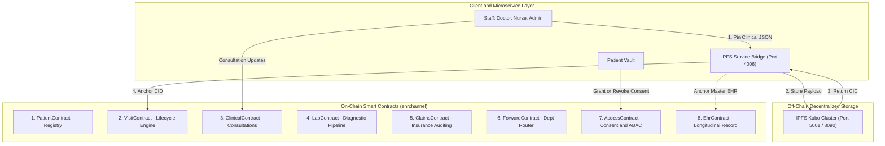
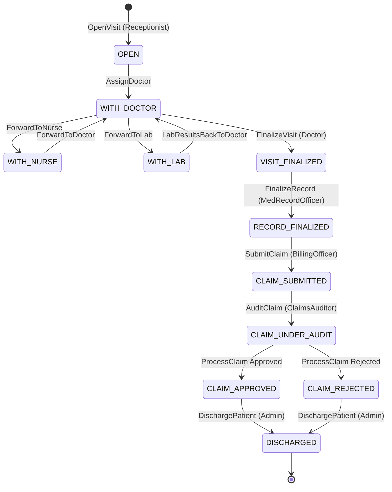

# 📜 Hyperledger Fabric Smart Contract Specification (Chaincode: `ehr:1.0`)

   

---

## 📌 Executive Summary

The **EHR Smart Contract (`ehr`)** is an enterprise-grade, decentralized healthcare chaincode deployed on Hyperledger Fabric v2.5 across the consortium channel `ehrchannel`. It coordinates medical workflows, cryptographic access control, and financial settlement across three federated organizations:
1. **Hospital Organization (`HospitalMSP`)**: Receptionists, Doctors, Nurses, Pharmacists, Admins, Medical Record Officers.
2. **Diagnostics Organization (`DiagnosticsMSP`)**: Lab Receptionists, Technicians, Radiologists, Lab Supervisors.
3. **Provider Organization (`ProviderMSP`)**: Billing Officers, Claims Auditors, Insurance Officers.

The chaincode strictly decouples **Off-Chain IPFS Content Storage** from **On-Chain State Transitions and Access Grants**, guaranteeing GDPR/HIPAA compliance, patient data sovereignty, and zero ledger bloat.

---

## 🧬 Architectural Principles



### 1. Off-Chain IPFS + On-Chain Anchoring
* Sensitive Protected Health Information (PHI)—such as consultation notes, vitals histories, lab result PDFs, and prescription lists—is **never stored directly on the blockchain ledger**.
* Clinical documents are encrypted with AES-256-GCM and pinned to **IPFS Kubo nodes**.
* The smart contract strictly records the **Content Identifier (IPFS CID)**, timestamp, modifying user ID, and change reason within an immutable `cidHistory` array.

### 2. Attribute-Based Access Control (ABAC)
* Access permissions are enforced at the smart contract level using X.509 digital certificates.
* When users enroll via the Fabric CA (`enroll.sh`), specific attributes are embedded into their certificate extension:
  * Role: `--id.attrs "role=doctor:ecert"`
  * Patient ID: `--id.attrs "patientId=PAT-001:ecert"`
* Every transaction invocation extracts caller metadata via `ctx.clientIdentity` to verify authorized roles before modifying state.

### 3. Patient Data Sovereignty & Consent Engine
* Hospital staff cannot view a patient's historical medical record without an active, non-expired on-chain consent grant (`AccessContract`).
* Patients can grant, revoke, or inspect access permissions on a per-section basis (`ehr`, `visits`, `prescriptions`, `labResults`, or `all`).

---

## 🔄 Visit Lifecycle State Machine



---

## 🗄️ Ledger Key Namespaces & State Schemas

| Namespace | Key Format | Description | Primary Fields |
| :--- | :--- | :--- | :--- |
| **`PATIENT`** | `PATIENT:<patientId>` | Master patient demographic asset | `patientId`, `name`, `age`, `gender`, `bloodGroup`, `contact`, `address`, `visitIds[]`, `ehrCID` |
| **`VISIT`** | `VISIT:<visitId>` | Individual clinical encounter | `visitId`, `patientId`, `status`, `assignedDoctor`, `assignedNurse`, `visitCID`, `cidHistory[]`, `claimStatus` |
| **`ACCESS`** | `ACCESS:<patientId>` | Patient consent grants and access audits | `patientId`, `grants[]`, `requests[]`, `auditLog[]` |
| **`EHR`** | `EHR:<patientId>` | Master longitudinal health record | `patientId`, `currentCID`, `cidHistory[]`, `createdAt`, `updatedAt` |

---

## 📚 Complete Smart Contract Function Reference

The chaincode exports **8 Contract Classes** containing **33 callable functions**:

### 1. `PatientContract` (Master Patient Registry)

#### 1.1 `RegisterPatient(patientId, name, age, gender, bloodGroup, contact, address, initialEhrCID)`
* **Invoker Role:** `receptionist`, `admin`
* **Purpose:** Creates a new master patient record on the ledger.
* **Parameters:**
  * `patientId` *(string)*: Unique identifier (e.g., `PAT-001`).
  * `name` *(string)*: Full legal name.
  * `age` *(string/number)*: Age in years.
  * `gender` *(string)*: Gender (`Male`, `Female`, `Other`).
  * `bloodGroup` *(string)*: Blood type (`A+`, `O-`, etc.).
  * `contact` *(string)*: Phone number.
  * `address` *(string)*: Residential address.
  * `initialEhrCID` *(string, optional)*: IPFS CID of initialized empty EHR JSON.
* **Returns:** JSON representation of the created patient asset.
* **State Changes:** Writes `PATIENT:<patientId>` to ledger.

#### 1.2 `GetPatient(patientId)`
* **Invoker Role:** Any authenticated staff member, the patient themselves, or an identity holding an active read grant.
* **Purpose:** Queries master patient demographics, visit count, visit ID index, and master `ehrCID`.
* **Returns:** JSON patient asset.

#### 1.3 `PatientExists(patientId)`
* **Invoker Role:** Any authenticated identity.
* **Purpose:** Fast boolean check whether a patient key exists.
* **Returns:** JSON boolean (`true` / `false`).

#### 1.4 `GetPatientVisits(patientId)`
* **Invoker Role:** Staff / Patient with `visits` access grant.
* **Purpose:** Returns the array of visit IDs associated with the patient (`["VISIT-PAT001-1", "VISIT-PAT001-2"]`).
* **Returns:** JSON array of strings.

#### 1.5 `GetPatientHistory(patientId)`
* **Invoker Role:** Staff / Patient.
* **Purpose:** Returns the complete Hyperledger Fabric block modification history for the patient record.
* **Returns:** Array of `{ txId, timestamp, isDelete, value }`.

#### 1.6 `UpdatePatientInfo(patientId, contact, address)`
* **Invoker Role:** `receptionist`, `admin`
* **Purpose:** Updates non-clinical patient contact details and address.
* **Returns:** Updated JSON patient asset.

#### 1.7 `SetPatientEhrCID(patientId, ehrCID)`
* **Invoker Role:** `receptionist`, `admin`
* **Purpose:** Updates or re-anchors the master longitudinal EHR IPFS CID for a patient.
* **Returns:** Updated JSON patient asset.

#### 1.8 `ListAllPatients()`
* **Invoker Role:** `receptionist`, `admin`
* **Purpose:** Performs a range query from `PATIENT:` to `PATIENT;` returning all registered patients.
* **Returns:** JSON array of all patient objects.

---

### 2. `VisitContract` (Clinical Visit Lifecycle)

#### 2.1 `OpenVisit(patientId, chiefComplaint, visitCID)`
* **Invoker Role:** `receptionist`, `admin`
* **Purpose:** Opens a new clinical visit encounter. Automatically increments `patient.visitCount` and formats ID as `VISIT-<patientId>-<visitNumber>`.
* **Parameters:**
  * `patientId` *(string)*: Target patient ID.
  * `chiefComplaint` *(string)*: Intake clinical summary (stored in off-chain JSON).
  * `visitCID` *(string)*: IPFS CID of initial visit JSON document.
* **Initial State:** Status set to `OPEN`, attaches initial entry in `cidHistory[]`.

#### 2.2 `UpdateVisitCID(visitId, newCID, reason)`
* **Invoker Role:** Any active clinical or laboratory staff member (`doctor`, `nurse`, `pharmacist`, `medrecordofficer`, `labtechnician`, `billingofficer`).
* **Purpose:** Core off-chain bridge. Appends `newCID` to `cidHistory[]` with the caller ID, timestamp, and modification reason, updating `visitCID`.
* **Returns:** Updated JSON visit object.

#### 2.3 `GetVisitCID(visitId)`
* **Invoker Role:** Clinical staff / Patient with access grant.
* **Purpose:** Retrieves `{ visitId, visitCID }` so backends can fetch the decrypted clinical payload from IPFS.

#### 2.4 `AssignDoctor(visitId, doctorId, visitCID)`
* **Invoker Role:** `receptionist`, `admin`
* **Purpose:** Assigns the primary attending physician. Sets status to `WITH_DOCTOR`.

#### 2.5 `AssignNurse(visitId, nurseId, visitCID)`
* **Invoker Role:** `receptionist`, `doctor`, `admin`
* **Purpose:** Assigns a floor nurse to the encounter for vitals monitoring.

#### 2.6 `FinalizeVisit(visitId, visitCID)`
* **Invoker Role:** `doctor`
* **Pre-condition:** Visit status must be in an active clinical state (`WITH_DOCTOR`, `WITH_NURSE`, `WITH_LAB`).
* **Purpose:** Concludes physician consultation. Sets status to `VISIT_FINALIZED`. `visitCID` must reflect the final clinical diagnosis in IPFS.

#### 2.7 `FinalizeRecord(visitId, visitCID)`
* **Invoker Role:** `medrecordofficer`
* **Pre-condition:** Visit status must be `VISIT_FINALIZED`.
* **Purpose:** Medical Records Officer verifies medical coding and seals the encounter, changing status to `RECORD_FINALIZED`.

#### 2.8 `DischargePatient(visitId, visitCID)`
* **Invoker Role:** `admin`
* **Pre-condition:** Visit status must be `CLAIM_APPROVED`, `CLAIM_REJECTED`, or `RECORD_FINALIZED`.
* **Purpose:** Completes hospital discharge. Sets status to `DISCHARGED`.

#### 2.9 `GetVisit(visitId)`
* **Invoker Role:** Clinical staff / Patient with access.
* **Purpose:** Fetches the full on-chain visit metadata, claim status, staff assignments, and IPFS pointers.

#### 2.10 `GetVisitHistory(visitId)`
* **Invoker Role:** Staff / Patient with access.
* **Purpose:** Full block transaction history of the visit key on the ledger.

#### 2.11 `GetCIDHistory(visitId)`
* **Invoker Role:** Staff / Patient with access.
* **Purpose:** Returns the complete version history array of every IPFS CID attached to the encounter.

#### 2.12 `ListAllVisits()`
* **Invoker Role:** Authenticated staff.
* **Purpose:** Range scan across all visits (`VISIT:*`).

#### 2.13 `GetPatientVisitsFull(patientId)`
* **Invoker Role:** Staff / Patient.
* **Purpose:** Queries and resolves all complete visit records belonging to a patient.

---

### 3. `ClinicalContract` (Consultations & Dispensation)

#### 3.1 `UpdateDiagnosisNotes(visitId, visitCID)`
* **Invoker Role:** `doctor`
* **Pre-condition:** Visit must be in active status.
* **Purpose:** Anchors updated clinical diagnosis notes in IPFS.

#### 3.2 `RecordVitals(visitId, visitCID)`
* **Invoker Role:** `nurse`
* **Pre-condition:** Visit must be in active status.
* **Purpose:** Anchors patient vital sign recordings (BP, pulse, SpO2, temp) in IPFS.

#### 3.3 `AddCareNote(visitId, visitCID)`
* **Invoker Role:** `nurse`
* **Pre-condition:** Visit must be in active status.
* **Purpose:** Appends nursing care and inpatient monitoring notes to the IPFS payload.

#### 3.4 `UpdatePrescription(visitId, visitCID)`
* **Invoker Role:** `doctor`
* **Pre-condition:** Visit must be in active status.
* **Purpose:** Commits electronic prescription orders to the visit record.

#### 3.5 `DispenseMedication(visitId, visitCID)`
* **Invoker Role:** `pharmacist`
* **Pre-condition:** Visit must be in status `VISIT_FINALIZED`.
* **Purpose:** Hospital pharmacist signs off on medication dispensation, recording fulfillment timestamp and pharmacist ID.

---

### 4. `LabContract` (Diagnostics & Lab Pipeline)

#### 4.1 `AcknowledgeLabRequest(visitId, labRequestId, visitCID)`
* **Invoker Role:** `labreceptionist`, `labadmin`
* **Purpose:** Laboratory intake desk acknowledges receipt of diagnostic test request. Appends reason `LAB_ACKNOWLEDGED:<labRequestId>`.

#### 4.2 `SubmitLabResult(visitId, labRequestId, visitCID)`
* **Invoker Role:** `labtechnician`, `radiologist`, `labadmin`
* **Purpose:** Lab technician uploads completed diagnostic values and anchors report PDF hash in IPFS. Appends reason `LAB_RESULT_SUBMITTED:<labRequestId>`.

#### 4.3 `ApproveLabResult(visitId, labRequestId, visitCID)`
* **Invoker Role:** `labsupervisor`, `labadmin`
* **Purpose:** Chief pathologist / supervisor approves lab results. **Automatically transitions visit status back to `WITH_DOCTOR`** for clinical review.

---

### 5. `ClaimsContract` (Insurance Claims & Financial Auditing)

#### 5.1 `SubmitClaim(visitId, claimId, claimAmount, visitCID)`
* **Invoker Role:** `billingofficer`
* **Pre-condition:** Visit status must be `RECORD_FINALIZED`.
* **Parameters:** `claimId` *(string)*, `claimAmount` *(numeric string, must be > 0)*.
* **Purpose:** Initiates reimbursement claim. Sets status to `CLAIM_SUBMITTED`.

#### 5.2 `AuditClaim(visitId, auditNotes, visitCID)`
* **Invoker Role:** `claimsauditor`
* **Pre-condition:** Visit status must be `CLAIM_SUBMITTED`.
* **Purpose:** Third-party claims auditor evaluates medical necessity against billing codes. Sets status to `CLAIM_UNDER_AUDIT`.

#### 5.3 `ProcessClaim(visitId, decision, reason, visitCID)`
* **Invoker Role:** `insuranceofficer`
* **Pre-condition:** Visit status must be `CLAIM_UNDER_AUDIT`.
* **Parameters:**
  * `decision`: Must be either `'APPROVED'` or `'REJECTED'`.
  * `reason`: Mandatory string if decision is `REJECTED`.
* **State Outcome:** Transitions status to `CLAIM_APPROVED` or `CLAIM_REJECTED`.

---

### 6. `ForwardContract` (Department Routing State Machine)

#### 6.1 `ForwardToNurse(visitId, visitCID)`
* **Invoker Role:** `doctor`
* **Pre-condition:** An assigned nurse must be on record (`visit.assignedNurse`).
* **Outcome:** Moves visit status to `WITH_NURSE`.

#### 6.2 `ForwardToDoctor(visitId, visitCID)`
* **Invoker Role:** `nurse`
* **Pre-condition:** Visit status must be `WITH_NURSE`.
* **Outcome:** Returns visit status to `WITH_DOCTOR`.

#### 6.3 `ForwardToLab(visitId, labRequestId, visitCID)`
* **Invoker Role:** `doctor`
* **Outcome:** Moves visit status to `WITH_LAB` with the assigned diagnostic requisition ID.

#### 6.4 `LabResultsBackToDoctor(visitId, labRequestId, visitCID)`
* **Invoker Role:** `labsupervisor`, `labadmin`, `admin`
* **Outcome:** Routes finalized diagnostic results back to `WITH_DOCTOR`.

---

### 7. `AccessContract` (Patient Consent & ABAC Engine)

#### 7.1 `GrantAccess(patientId, granteeId, granteeRole, sectionsJson, expiresAt)`
* **Invoker Role:** `patientService` *(patient-api service identity verified via patient JWT)* or `admin` *(emergency override)*.
* **Parameters:**
  * `granteeId` *(string)*: Identity receiving access (e.g., `doctor`).
  * `granteeRole` *(string)*: Role classification (e.g., `doctor`).
  * `sectionsJson` *(string array)*: Valid sections: `["ehr", "visits", "prescriptions", "labResults", "all"]`.
  * `expiresAt` *(string)*: Future ISO-8601 timestamp or `""` for no expiry.
* **Behavior:** Revokes any existing active grant for the grantee and mints a new grant asset with unique `grantId`. Logs `GRANT` in audit log.

#### 7.2 `RevokeAccess(patientId, granteeId, reason)`
* **Invoker Role:** `patientService`, `admin`
* **Purpose:** Immediately invalidates an active grant. Marks `revoked: true` and logs `REVOKE` in audit log.

#### 7.3 `HasAccess(patientId, granteeId, section)`
* **Invoker Role:** Authenticated staff or `patientService`.
* **Purpose:** Evaluates whether an identity holds a non-revoked, non-expired grant matching the requested section.
* **Returns:** `{ hasAccess: boolean, grant: object | null }`.

#### 7.4 `GetAccessList(patientId)`
* **Invoker Role:** `patientService`, `admin`, or clinical staff.
* **Purpose:** Returns the complete access record including all active/historical grants and audit entries.

#### 7.5 `GetActiveGrants(patientId)`
* **Invoker Role:** `patientService`, staff.
* **Purpose:** Filters and returns only currently active, non-expired grants.

#### 7.6 `RequestAccess(patientId, sectionsJson, reason)`
* **Invoker Role:** `doctor`, `nurse`, `admin`
* **Purpose:** Clinician submits a formal request to inspect a patient's historical EHR. Creates a `PENDING` request item.

#### 7.7 `ApproveAccessRequest(patientId, requestId, expiresAt)`
* **Invoker Role:** `patientService`, `admin`
* **Purpose:** Patient reviews and approves doctor's pending access request, generating an active grant.

#### 7.8 `RejectAccessRequest(patientId, requestId, rejectReason)`
* **Invoker Role:** `patientService`, `admin`
* **Purpose:** Patient denies a pending access request with an optional reason.

#### 7.9 `GetAccessRequests(patientId)`
* **Invoker Role:** `patientService`, `admin`
* **Purpose:** Lists all access requests across all statuses (`PENDING`, `APPROVED`, `REJECTED`).

#### 7.10 `LogAccess(patientId, section)`
* **Invoker Role:** Any authenticated user.
* **Purpose:** **Tamper-proof compliance logger**. Backend invokes this after fetching and decrypting IPFS records to record a permanent `READ` audit event on-chain.

#### 7.11 `GetAuditLog(patientId)`
* **Invoker Role:** `patientService`, `admin`, `medrecordofficer`
* **Purpose:** Retrieves the unalterable audit trail of all access events.

---

### 8. `EhrContract` (Master Longitudinal Health Record)

#### 8.1 `InitEHR(patientId, initialCID)`
* **Invoker Role:** `receptionist`, `admin`
* **Purpose:** Initializes the patient's lifelong EHR master record on-chain with the root IPFS template CID.

#### 8.2 `UpdateEHRCID(patientId, newCID, section, reason)`
* **Invoker Role:** `doctor`, `nurse` *(requires verified patient consent grant)* or `admin`.
* **Purpose:** Updates master medical profile (allergies, chronic illnesses, immunizations) and archives old CID into `cidHistory[]`.

#### 8.3 `GetCurrentCID(patientId)`
* **Invoker Role:** Staff / Patient with valid grant.
* **Purpose:** Returns `{ patientId, currentCID }` for loading current master health profile from IPFS.

#### 8.4 `GetEHRCIDHistory(patientId)`
* **Invoker Role:** Staff / Patient with valid grant.
* **Purpose:** Chronological audit trail of all past CIDs for the patient's master record.

#### 8.5 `GetEHRRecord(patientId)`
* **Invoker Role:** Staff / Patient with valid grant.
* **Purpose:** Full on-chain metadata wrapper.

#### 8.6 `GetEHRBlockHistory(patientId)`
* **Invoker Role:** Staff / Patient with valid grant.
* **Purpose:** Block-by-block cryptographic audit trail of the EHR state key.

---

## 🛡️ Role-Based Access Matrix (ABAC)

| Smart Contract Method | Receptionist | Doctor | Nurse | Pharmacist | Lab Tech / Super | Billing Officer | Claims Auditor | Ins. Officer | Med Record | Patient Service | Admin |
| :--- | :---: | :---: | :---: | :---: | :---: | :---: | :---: | :---: | :---: | :---: | :---: |
| `RegisterPatient` | ✅ | ❌ | ❌ | ❌ | ❌ | ❌ | ❌ | ❌ | ❌ | ❌ | ✅ |
| `OpenVisit` | ✅ | ❌ | ❌ | ❌ | ❌ | ❌ | ❌ | ❌ | ❌ | ❌ | ✅ |
| `AssignDoctor` | ✅ | ❌ | ❌ | ❌ | ❌ | ❌ | ❌ | ❌ | ❌ | ❌ | ✅ |
| `AssignNurse` | ✅ | ✅ | ❌ | ❌ | ❌ | ❌ | ❌ | ❌ | ❌ | ❌ | ✅ |
| `UpdateDiagnosisNotes`| ❌ | ✅ | ❌ | ❌ | ❌ | ❌ | ❌ | ❌ | ❌ | ❌ | ❌ |
| `RecordVitals` | ❌ | ❌ | ✅ | ❌ | ❌ | ❌ | ❌ | ❌ | ❌ | ❌ | ❌ |
| `AddCareNote` | ❌ | ❌ | ✅ | ❌ | ❌ | ❌ | ❌ | ❌ | ❌ | ❌ | ❌ |
| `UpdatePrescription` | ❌ | ✅ | ❌ | ❌ | ❌ | ❌ | ❌ | ❌ | ❌ | ❌ | ❌ |
| `DispenseMedication` | ❌ | ❌ | ❌ | ✅ | ❌ | ❌ | ❌ | ❌ | ❌ | ❌ | ❌ |
| `SubmitLabResult` | ❌ | ❌ | ❌ | ❌ | ✅ | ❌ | ❌ | ❌ | ❌ | ❌ | ✅ |
| `ApproveLabResult` | ❌ | ❌ | ❌ | ❌ | ✅ | ❌ | ❌ | ❌ | ❌ | ❌ | ✅ |
| `FinalizeVisit` | ❌ | ✅ | ❌ | ❌ | ❌ | ❌ | ❌ | ❌ | ❌ | ❌ | ❌ |
| `FinalizeRecord` | ❌ | ❌ | ❌ | ❌ | ❌ | ❌ | ❌ | ❌ | ✅ | ❌ | ❌ |
| `SubmitClaim` | ❌ | ❌ | ❌ | ❌ | ❌ | ✅ | ❌ | ❌ | ❌ | ❌ | ❌ |
| `AuditClaim` | ❌ | ❌ | ❌ | ❌ | ❌ | ❌ | ✅ | ❌ | ❌ | ❌ | ❌ |
| `ProcessClaim` | ❌ | ❌ | ❌ | ❌ | ❌ | ❌ | ❌ | ✅ | ❌ | ❌ | ❌ |
| `DischargePatient` | ❌ | ❌ | ❌ | ❌ | ❌ | ❌ | ❌ | ❌ | ❌ | ❌ | ✅ |
| `GrantAccess` | ❌ | ❌ | ❌ | ❌ | ❌ | ❌ | ❌ | ❌ | ❌ | ✅ | ✅ |
| `RevokeAccess` | ❌ | ❌ | ❌ | ❌ | ❌ | ❌ | ❌ | ❌ | ❌ | ✅ | ✅ |
| `RequestAccess` | ❌ | ✅ | ✅ | ❌ | ❌ | ❌ | ❌ | ❌ | ❌ | ❌ | ✅ |
| `UpdateEHRCID` | ❌ | 🔑* | 🔑* | ❌ | ❌ | ❌ | ❌ | ❌ | ❌ | ✅ | ✅ |

*\*Note: 🔑 requires an active, patient-authorized on-chain consent grant for section `'ehr'`.*

---

## 💻 CLI Invocation Examples

You can test chaincode functions directly via the Fabric CLI containers:

### 1. Register a Patient
```bash
peer chaincode invoke \
  -o orderer.example.com:7050 \
  --ordererTLSHostnameOverride orderer.example.com \
  --tls --cafile /path/to/orderer/ca.crt \
  -C ehrchannel -n ehr \
  --peerAddresses peer0.hospital.example.com:7051 \
  --tlsRootCertFiles /path/to/peer0/ca.crt \
  -c '{"function":"PatientContract:RegisterPatient","Args":["PAT-001","John Doe","42","Male","O+","9876543210","123 Medical Way","QmEmptyEhrTemplateCID"]}'
```

### 2. Open a Clinical Visit
```bash
peer chaincode invoke \
  -o orderer.example.com:7050 \
  --ordererTLSHostnameOverride orderer.example.com \
  --tls --cafile /path/to/orderer/ca.crt \
  -C ehrchannel -n ehr \
  --peerAddresses peer0.hospital.example.com:7051 \
  --tlsRootCertFiles /path/to/peer0/ca.crt \
  -c '{"function":"VisitContract:OpenVisit","Args":["PAT-001","Severe chest pain","QmInitialVisitCID"]}'
```

### 3. Patient Grants Doctor Consent
```bash
peer chaincode invoke \
  -o orderer.example.com:7050 \
  --ordererTLSHostnameOverride orderer.example.com \
  --tls --cafile /path/to/orderer/ca.crt \
  -C ehrchannel -n ehr \
  --peerAddresses peer0.hospital.example.com:7051 \
  --tlsRootCertFiles /path/to/peer0/ca.crt \
  -c '{"function":"AccessContract:GrantAccess","Args":["PAT-001","doctor","doctor","[\"ehr\",\"visits\"]","2026-12-31T23:59:59Z"]}'
```

### 4. Query Visit on Ledger
```bash
peer chaincode query \
  -C ehrchannel -n ehr \
  -c '{"function":"VisitContract:GetVisit","Args":["VISIT-PAT-001-1"]}'
```

---

## 🎯 Top Viva & Evaluation Q&As on Smart Contracts

**Q1: Where are medical records actually stored? Why not on the blockchain?**
> *"Medical records, PDFs, and diagnostic notes are encrypted with AES-256 and stored off-chain on IPFS. The blockchain only stores cryptographic CIDs and state hashes. This prevents ledger bloat, ensures sub-second query performance, and satisfies GDPR right-to-erasure and HIPAA compliance regulations."*

**Q2: How does the smart contract prevent a doctor from tampering with another doctor's visit?**
> *"Every transaction extracts caller identity attributes from X.509 certificates via `ctx.clientIdentity`. The `VisitContract` enforces an active state machine (`OPEN` ➔ `WITH_DOCTOR` ➔ `VISIT_FINALIZED`). Once a visit is `RECORD_FINALIZED`, the doctor cannot alter diagnoses, and the contract rejects any further clinical updates."*

**Q3: How does Attribute-Based Access Control (ABAC) work inside the chaincode?**
> *"User roles (e.g. `doctor`, `pharmacist`, `billingofficer`) are cryptographically bound into certificate extensions by the Fabric CA during registration. Functions in `lib/accessControl.js` (like `requireRole(ctx, 'doctor')`) inspect these certificate attributes before allowing any contract state mutations."*
