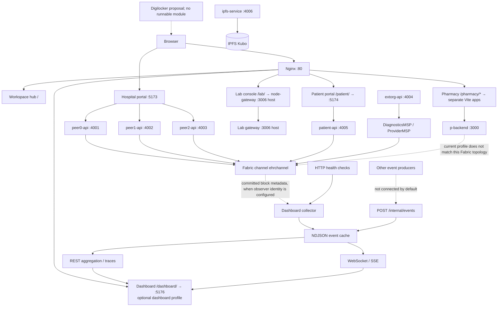

# Current system architecture

This diagram describes the repository's current local Compose wiring. It separates present services from optional or incomplete integrations. A running UI/API container is not evidence that its Fabric, IPFS, or cross-organization dependency is connected.

## Request and event paths

1. The browser opens the single-entry hub or a portal. Nginx routes `/patient/`, `/dashboard/`, `/pharmacy/…`, and `/lab/`. The hospital staff Vite server is also directly available at port `5173`.
2. Hospital portal APIs route to peer0, peer1, peer2, extorg, patient, and IPFS services on ports `4001`–`4006`.
3. Fabric peers share the configured `ehrchannel`; current organization IDs are `HospitalMSP`, `DiagnosticsMSP`, and `ProviderMSP`. The root startup script starts existing Fabric services, but does not enroll identities, reinitialize a channel, or deploy chaincode.
4. The optional dashboard observes committed Fabric blocks and configured HTTP health endpoints. Its event cache is local NDJSON. Other services must send events to `/internal/events` using the service key; that route is not exposed by Nginx.
5. The dashboard API supplies role-filtered REST results and WebSocket/SSE events. It does not write to Fabric. Mock events are synthetic, explicitly marked, and separate from real-source status.
6. The pharmacy UI/API are kept independent. Current pharmacy configuration is not aligned with the active hospital Fabric topology, so ledger-backed pharmacy actions must be shown as unavailable until the owning team supplies the matching integration.

## Trust and data boundaries

- Portal theme state is presentation preference only; authorization is server-side.
- Dashboard event envelopes reject raw patient identifiers, names, clinical values, and AI narrative. Non-admin event views omit `patientIdHash`.
- Dashboard role authorization is defined in `dashboard-api/config/authorization.json`, with default deny.
- The NDJSON store is operational telemetry, not the authoritative audit ledger and not tamper-evident.
- Digilocker, production FHIR/ABDM conformance, and legal certification are not delivered by this repository state.
