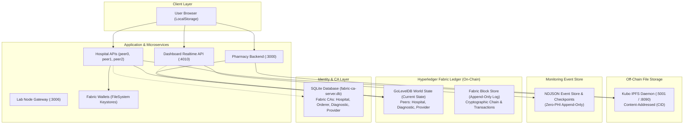
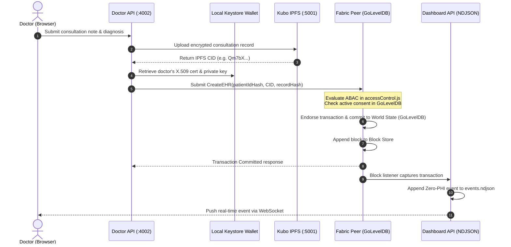
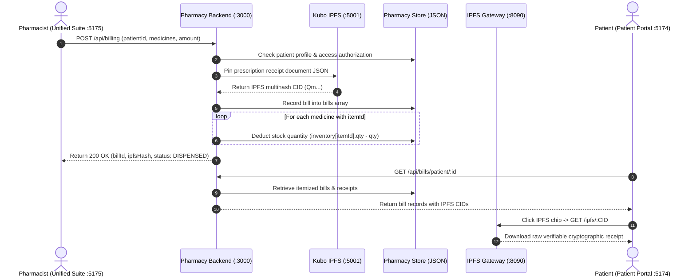

# EHR Blockchain Platform — Database & Storage Architecture

This document provides a comprehensive guide to all databases, ledgers, off-chain storage systems, and local state persistence used across the Electronic Health Record (EHR) Blockchain platform.

---

## 1. Storage Layers Overview

The platform uses a **hybrid on-chain / off-chain storage architecture** designed for high security, data privacy, and scalability in healthcare environments:



---

## 2. Summary Comparison Matrix

| Storage Layer | Engine / Technology | Container / Host Location | Key Data Stored | Access Pattern |
|---|---|---|---|---|
| **World State Database** | **GoLevelDB** (embedded KV store) | Peer containers: `/var/hyperledger/production` (Docker volumes) | Current state of patients, visits, vitals, prescriptions, consents, and IPFS CIDs | Key-value lookup, range queries via Smart Contracts |
| **Blockchain Block Store** | **Fabric Ledger Block Log** (binary append-only) | `/var/hyperledger/production/ledgersData` | Full transaction history, block headers, signatures, Merkle roots, and RWSet | Append-only block commit by Orderer & Peers |
| **Off-Chain Document Storage** | **Kubo IPFS** (`ipfs/kubo:latest`) | Container `ipfs.ehr.local` (`:5001` API, `:8090` gateway), volume `ipfs_data` | Large medical records, consultation notes JSON, diagnostic PDFs, lab scans, prescription sheets | Content-addressed lookup by hash (CID) |
| **Identity & CA Database** | **SQLite** (`fabric-ca-server.db`) | `organizations/peerOrganizations/*/ca/fabric-ca-server.db` | User accounts, enrollment secrets, roles, X.509 certs, CRLs | Relational queries by Fabric CA daemon |
| **Dashboard Event Store** | **NDJSON Document Store** | Host: `dashboard-api/data/events.ndjson` & `checkpoints.json` | Real-time monitoring events, alert states, AI execution run metrics (Zero-PHI only) | Append-only log with cursor pagination & in-memory indexes |
| **Client Identity Wallets** | **File-System Keystore** | Host: `*/wallet/` in each API service | User private keys (`priv_sk`) and X.509 digital certificates | Local filesystem reads to sign Fabric transactions |
| **Browser Session Storage** | **Browser LocalStorage** | User's browser | JWT tokens (`ehr_dashboard_token`), username, role, theme preference | Client-side synchronous read/write |

---

## 3. Detailed Storage Specifications

### 3.1 Hyperledger Fabric Ledger & World State (GoLevelDB)

Each Hyperledger Fabric peer node maintains its own copy of the channel ledgers:
- `ehrchannel`: Clinical, laboratory, and pharmacy consortium transactions across all 3 MSPs.
- `insurancechannel`: Confidential insurance claims adjudication, co-pay calculation, and settlement strictly between `HospitalMSP` and `ProviderMSP`.

Each channel ledger is composed of:
1. **The Block Store**: An immutable append-only chain of blocks recording every valid transaction since genesis.
2. **The World State (State Database)**: An embedded **GoLevelDB** database holding the latest key-value state of smart contract assets.

#### Configuration Reference
- Defined in `orgs/hospital/EHR_hospitalOrg-main/ehr-network/configtx/core.yaml`:
  ```yaml
  ledger:
    state:
      stateDatabase: goleveldb
      totalQueryLimit: 100000
  ```
- Stored inside persistent Docker volumes:
  - `peer0.hospital.example.com:/var/hyperledger/production`
  - `peer1.hospital.example.com:/var/hyperledger/production`
  - `peer2.hospital.example.com:/var/hyperledger/production`
  - `peer0.diagnostic.example.com:/var/hyperledger/production`
  - `peer0.provider.example.com:/var/hyperledger/production`

#### Data Schemas Managed on GoLevelDB
The state is managed by 13 smart contracts deployed on `ehrchannel`:

- **Patient Contract (`patientContract.js`)**:
  - `patientId`: Unique patient identifier (`PATIENT_<patientId>`).
  - `did`: W3C Decentralized Identifier (`did:ehr:<sha256>`).
  - `demographics`: Minimal demographic metadata (age, gender, blood group, encrypted contact).
  - `registrationDate`: ISO timestamp.
- **Visit Contract (`visitContract.js`)**:
  - `visitId`: Unique encounter identifier (`VISIT_<visitId>`).
  - `patientId`: Reference to owning patient.
  - `doctorId`: Assigned consulting clinician.
  - `status`: `CREATED`, `DOCTOR_ASSIGNED`, `IN_CONSULTATION`, `PENDING_LAB`, `LAB_COMPLETED`, `PENDING_PHARMACY`, `COMPLETED`.
  - `diagnosisNotes`: Consultation examination notes.
  - `diseaseCode`: ICD-10 diagnostic code with clinician override justification.
- **Clinical Contract (`clinicalContract.js`) & EHR Contract (`ehrContract.js`)**:
  - `recordId`: Unique EHR asset ID.
  - `patientId`: Reference to owner patient.
  - `vitals`: Blood pressure, heart rate, temperature, SpO2.
  - `prescriptions`: Prescribed medication names, dosages, and quantities.
  - `ipfsCid`: Hash pointer to the off-chain clinical document on IPFS.
  - `recordHash`: SHA-256 cryptographic checksum of the off-chain file.
  - `authorMsp`: Submitting organization MSP (`HospitalMSP`).
- **Access Control & Consent Contract (`accessContract.js`)**:
  - `consentId`: Unique consent grant reference (`CONSENT_<patientId>_<granteeId>`).
  - `patientId`: Granting patient.
  - `granteeId` / `granteeRole`: Authorized practitioner ID and role.
  - `status`: `ACTIVE`, `REVOKED`, or `EXPIRED`.
  - `expiresAt`: Validity epoch timestamp.
  - `emergencyOverride`: Boolean flag for audited "break-glass" emergency access.
- **Lab Contract (`labContract.js`)**:
  - `requestId`: Lab requisition ID (`LAB_<requestId>`).
  - `visitId`: Associated clinical encounter.
  - `status`: `REQUESTED`, `ACKNOWLEDGED`, `ANALYZED`, `APPROVED`.
  - `resultsHash`: Cryptographic SHA-256 hash of laboratory biomarker report.
  - `supervisorSignature`: Verification signature of authorizing supervisor.
- **Claims Contract (`claimsContract.js` on `insurancechannel`)**:
  - `claimId`: Insurance reimbursement claim ID (`CLAIM:<claimId>`).
  - `visitId`: Clinical encounter reference (`VISIT:<visitId>`).
  - `claimStatus`: `SUBMITTED`, `UNDER_AUDIT`, `APPROVED`, `REJECTED`, `PARTIAL_APPROVAL`.
  - `claimAmount`: Claimed reimbursement amount.
  - `approvedAmount`: Net approved insurer settlement payout.
  - `copayAmount`: Patient deductible / co-pay contribution (e.g. 15%).
  - `claimCID`: Pointer to off-chain Selective Disclosure IPFS Packet (`SelectiveDisclosureClaimPacket`).
  - `auditedBy` / `auditNotes`: Claims auditor findings on medical necessity.
  - `processedBy` / `processedAt`: Senior adjudicator identity and timestamp.
  - `channel`: `insurancechannel`.
- **FHIR R4 Contract (`fhirContract.js`)**:
  - `recordKey`: Structured standard resource key (`RECORD~<patientIdHash>~<recordId>`).
  - `resourceType`: `Patient`, `Encounter`, `Observation`, `DiagnosticReport`, etc.
  - `dataCID`: Content-addressed pointer on Kubo IPFS.
  - `patientRecordHash`: Cryptographic checksum of canonical FHIR JSON.
- **DigiLocker Contract (`digilockerContract.js`)**:
  - `docHash`: Cryptographic SHA-256 hash of authentic clinical PDF (`DOC~<docHash>`).
  - `patientIdHash`: Keyed HMAC hash of patient identifier (Zero-PHI).
  - `docType`: `CBC`, `PRESCRIPTION`, `DISCHARGE_SUMMARY`.
  - `ipfsCid`: Pinned encrypted PDF location.
- **DID Contract (`didContract.js`)**:
  - `didUri`: W3C Decentralized Identifier (`DID_did:ehr:<hash>`).
  - `publicKey`: Digital signature public key for cryptographic verification.
- **Code Contract (`codeContract.js`)**:
  - `code`: ICD-10 medical ontology classification and clinician override audit log.
- **Stats Contract (`statsContract.js`)**:
  - `metrics`: Aggregate block counts, active encounters, and consortium telemetry.

---

### 3.2 Off-Chain File Storage (Kubo IPFS)

- **Container**: `ipfs.ehr.local` (`ipfs/kubo:latest`)
- **Ports**: API on `5001`, Read-only HTTP Gateway on `8090`
- **Volume**: `ipfs_data:/data/ipfs`

#### Why IPFS is Used
Storing full medical PDFs, imaging files (X-rays, MRIs), or multi-page consultation notes directly in blockchain blocks causes ledger bloat, slow gossip replication, and high storage costs.

#### Data Stored
- Full consultation notes in raw JSON/HL7 format.
- Diagnostic lab report PDFs and imaging scans.
- Detailed pharmacy medication guidance sheets and itemized invoices.
- **Anchoring Mechanism**: When an asset is stored on IPFS, Kubo produces an immutable Content Identifier (CID). The application writes only the **CID + SHA-256 hash** to the Fabric ledger. Any tampering with the IPFS file invalidates the hash.

---

### 3.3 Certificate Authority Database (SQLite)

- **Engine**: SQLite 3 database file (`fabric-ca-server.db`)
- **Containers**: `ca-hospital`, `ca-orderer`, `ca-diagnostics`, `ca-provider`
- **Host Location**:
  - `orgs/hospital/EHR_hospitalOrg-main/ehr-network/organizations/peerOrganizations/hospital.example.com/ca/fabric-ca-server.db`
  - `.../diagnostic.example.com/ca/fabric-ca-server.db`
  - `.../provider.example.com/ca/fabric-ca-server.db`
  - `.../ordererOrganizations/example.com/ca/fabric-ca-server.db`

#### Data Stored
- User identity registry (`users` table): Usernames, hashed passwords, identity types (`client`, `peer`, `orderer`, `admin`).
- Organizational affiliations and roles (`doctor`, `nurse`, `receptionist`, `pharmacist`, `labtech`, `hospitaladmin`).
- Issued digital certificates (`certificates` table): X.509 certificates, serial numbers, public keys, validity periods.
- Certificate Revocation Lists (CRL).

---

### 3.4 Dashboard Observability Store (NDJSON Document Store)

- **Engine**: Append-only Newline-Delimited JSON with in-memory indexes (`NdjsonEventStore.js`)
- **File Location**: `orgs/hospital/EHR_hospitalOrg-main/ehr-backend-v3/dashboard-api/data/events.ndjson`
- **Checkpoints**: `orgs/hospital/EHR_hospitalOrg-main/ehr-backend-v3/dashboard-api/data/checkpoints.json`

#### Data Stored
- Real-time operational events ingested from Fabric block listener and health pollers:
  - `TRANSACTION_COMMITTED`, `TRANSACTION_FAILED`, `MVCC_CONFLICT`
  - `PEER_STATUS_CHANGED`, `ORDERER_STATUS_CHANGED`, `IPFS_STATUS_CHANGED`
  - `AGENT_HEARTBEAT`, `AGENT_OFFLINE`, `AGENT_EXECUTION_COMPLETED`
  - `ACCESS_DENIED`, `CONSENT_GRANTED`, `CONSENT_REVOKED`
  - `ALERT_RAISED`, `ALERT_ACKNOWLEDGED`, `ALERT_RESOLVED`
- **Checkpoints**: The block height index currently processed to prevent re-processing historical blocks upon restart.
- **Zero-PHI Compliance**: Stored data is strictly restricted to metadata, timestamps, durations, and one-way hashes (`patientIdHash`). Raw clinical notes, patient names, and diagnoses never enter this database.

---

### 3.5 Client Identity Wallets (FileSystem Keystores)

- **Locations**:
  - `orgs/hospital/EHR_hospitalOrg-main/ehr-backend-v3/peer0-api/wallet/`
  - `orgs/hospital/EHR_hospitalOrg-main/ehr-backend-v3/peer1-api/wallet/`
  - `orgs/hospital/EHR_hospitalOrg-main/ehr-backend-v3/peer2-api/wallet/`
  - `orgs/pharmacy/fabric-network-swarm/app/backend/wallet/`

#### Data Stored
- Local JSON identity files holding:
  - The client's X.509 signing certificate (`cert.pem`).
  - The client's private ECDSA key (`priv_sk`).
  - MSP ID identification (`HospitalMSP`, `DiagnosticsMSP`, etc.).
- Used by the Fabric Node.js SDK Gateway to sign transaction proposals before sending them to peers for endorsement.

---

### 3.6 Browser LocalStorage

- **Location**: Browser `localStorage` sandbox per client origin.
- **Keys**:
  - `ehr_dashboard_token`: Signed HS256 JWT access token for Dashboard API requests.
  - `ehr_hospital_token`: JWT token for hospital staff portals.
  - `ehr_dashboard_user`: JSON profile of the logged-in user (`username`, `role`, `mspId`).
  - `ehr_appearance`: Persistent UI theme preference (`light` or `dark`).

---

### 3.7 Pharmacy Operational & Inventory Store (JSON State)

- **Location**: `orgs/pharmacy/fabric-network-swarm/app/backend/data/pharmacy_store.json`
- **Engine**: File-backed JSON persistence managed by `store.js`.
- **Purpose**: Provides atomic, persistent storage for pharmacy inventory stock, registered patient profiles, patient consent access-lists, itemized billing records, and pharmacy employee roles with automated inventory deduction and IPFS receipt pinning.

#### Managed Data Collections
1. **`inventory` (Stock Catalog & Quantities)**:
   - `itemId`: Unique medicine SKU (e.g., `MED-001`, `MED-002`).
   - `name`: Generic and brand name with dosage (e.g., `Amoxicillin 500mg`, `Ibuprofen 400mg`).
   - `quantity`: Current in-stock units (automatically deducted upon prescription issuance).
   - `price`: Unit price in USD.
   - `unit`: Measurement unit (`capsules`, `tablets`, `vials`, `inhalers`).
   - `ipfsHash`: Pinned IPFS CID representing the medication batch sheet or provenance document.
   - `patientId`: Associated patient reference or global stock indicator.
2. **`patients` (Demographics & Consent Registry)**:
   - `patientId`: Unique patient identifier (`PAT-001`, `PAT-014`, `PAT-021`, `testuser`).
   - `name`: Patient legal full name.
   - `age`: Patient age.
   - `certAlias`: Deterministic X.509 certificate mapping (`user1`, `user2`, etc.).
   - `accessList`: Array of authorized staff identities (`ph_alice`, `billing_office_1`) permitted to review prescription data.
3. **`bills` (Prescriptions & Dispensing Records)**:
   - `billId`: Cryptographic or timestamped bill ID (e.g., `BILL_1710001001`).
   - `patientId`: Target patient identifier.
   - `templateName`: Clinical prescription pack name (`Post-Op Recovery Pack`, `Chronic Care Monthly`).
   - `amount`: Total calculated or customized price.
   - `issuedBy`: Dispensing pharmacist or billing officer identity.
   - `medicineList`: Array of itemized medicines with quantities and SKU references.
   - `ipfsHash`: Pinned IPFS multihash CID for verifiable receipt download.
   - `status`: Dispensing state (`ACTIVE` or `DISPENSED`).
   - `txId`: On-chain transaction reference hash.
4. **`employees` (Staff Registry & Roles)**:
   - `userId`: Staff login identifier (`mgr_evelyn`, `ph_alice`, `inv_charlie`).
   - `role`: Role taxonomy (`manager`, `billing`, `inventory`, `patient`).
   - `name`: Full professional name.
   - `dept`: Department assignment (`Dispensing`, `Administration`, `Stock`).
   - `certMapped`: Mapped Fabric X.509 certificate identity.

---

## 4. End-to-End Data Flow

### 4.1 Clinical Consultation & Medical Record Creation

The following sequence illustrates how the different databases interact during a clinical encounter:



### 4.2 Pharmacy Dispensing, IPFS Pinning & Stock Deduction Flow



---

## 5. Security & Privacy Rules

1. **Zero-PHI On-Chain**: No plain-text Protected Health Information (PHI) is placed directly on the blockchain or in the monitoring logs.
2. **Cryptographic Integrity**: IPFS documents are verified against on-chain SHA-256 hashes to prevent undetected off-chain modifications.
3. **Decoupled Identity**: Private keys remain strictly within local service wallets or secure CA vaults; they are never sent to frontends or exposed in API payloads.
