# Hyperledger Fabric Smart Contracts — Chaincode ehr (v3.1)
## Attribute-Based Access Control (ABAC), State Machines, and Domain Separation across 13 Contracts

---

## 🏛️ Smart Contract Architecture Overview

The `ehr` chaincode package is deployed across **two channels**: `ehrchannel` (clinical and laboratory consortium) and `insurancechannel` (confidential claims adjudication between `HospitalMSP` and `ProviderMSP`). It implements a **modular multi-contract architecture** composed of **13 specialized domain contracts**. Rather than managing all healthcare entities inside a single monolithic chaincode, CareGrid separates clinical concerns, organizational jurisdictions, and regulatory compliance into dedicated contracts.

```mermaid
flowchart TD
    subgraph Gateways ["Consortium Gateway Tier (Port :4001 - :4007, :3006, :3000)"]
        G_HOSP["Hospital Gateways<br/>peer0-api (:4001), peer1-api (:4002), peer2-api (:4003)"]
        G_EXT["Diagnostics & Claims Gateway<br/>extorg-api (:4004)"]
        G_PAT["Patient Gateway & Vault<br/>patient-api (:4005), digilocker-service (:4007)"]
        G_LAB["Lab Multi-Agent Gateway<br/>l-node-gateway (:3006)"]
        G_PHARM["Pharmacy Core Gateway<br/>p-backend (:3000)"]
    end

    subgraph FabricChannel ["Hyperledger Fabric Network (ehrchannel)"]
        ROUTER["Chaincode Package Router (ehr:3.1 / index.js)"]

        subgraph CoreClinicalContracts ["Core Clinical Lifecycle Contracts"]
            C_PAT["PatientContract<br/>Registration, DID, Demographics"]
            C_VIS["VisitContract<br/>Encounter Flow, Doctor Queue, Discharge"]
            C_CLI["ClinicalContract<br/>Vitals, Diagnoses, Prescriptions, Dispensing"]
            C_FWD["ForwardContract<br/>Inter-Department Patient Routing"]
            C_LAB["LabContract<br/>Orders, Ingestion, Supervisor Hash Anchor"]
        end

        subgraph InteropSecurityContracts ["Interoperability, Privacy & Governance Contracts"]
            C_ACC["AccessContract<br/>Consent Grants, Revocations, Break-Glass"]
            C_DID["DidContract<br/>W3C DID Registry (did:ehr:hash)"]
            C_EHR["EhrContract<br/>Master Longitudinal Records & IPFS CIDs"]
            C_FHR["FhirContract<br/>HL7 FHIR R4 Standards Mapping"]
            C_DL["DigiLockerContract<br/>Government Clinical Document Vault"]
        end

        subgraph ClassificationAdminContracts ["Medical Coding & Consortium Metrics"]
            C_COD["CodeContract<br/>ICD-10 Disease Classification & Overrides"]
            C_CLM["ClaimsContract<br/>Insurance Claims Filing & Adjudication"]
            C_STA["StatsContract<br/>Ledger Aggregate Metrics & Block Height"]
        end
    end

    %% Gateway to Router Connections
    G_HOSP -->|"gRPC Fabric Gateway"| ROUTER
    G_EXT -->|"gRPC Fabric Gateway"| ROUTER
    G_PAT -->|"gRPC Fabric Gateway"| ROUTER
    G_LAB -->|"gRPC Fabric Gateway"| ROUTER
    G_PHARM -->|"gRPC Fabric Gateway"| ROUTER

    %% Router to Contracts
    ROUTER --> C_PAT & C_VIS & C_CLI & C_FWD & C_LAB
    ROUTER --> C_ACC & C_DID & C_EHR & C_FHR & C_DL
    ROUTER --> C_COD & C_CLM & C_STA
```

---

## 📜 Complete 13 Contracts Specification

### 1. `PatientContract` (`lib/patientContract.js`)
* **Primary Scope:** Governs patient identity anchoring, cryptographic DID association, and basic demographic profiles.
* **Access Rules:** Restricted to `receptionist`, `hospitaladmin`, and authorized system operators under `HospitalMSP`.
* **Key Methods:**
  * `registerPatient(ctx, patientId, name, age, gender, bloodGroup, contact, address)`: Emits patient registration on-chain, binds a new W3C DID (`did:ehr:<sha256>`), and initializes the patient root record.
  * `queryPatient(ctx, patientId)`: Returns the current on-chain state for a given patient.
  * `updatePatientDemographics(ctx, patientId, contact, address)`: Updates mutable contact information while preserving immutable DID bindings.
  * `getPatientHistory(ctx, patientId)`: Returns the full cryptographic provenance log of demographic changes.
* **Storage Key:** `PATIENT_<patientId>`

### 2. `VisitContract` (`lib/visitContract.js`)
* **Primary Scope:** Implements the clinical encounter state machine: `CREATED` $\rightarrow$ `DOCTOR_ASSIGNED` $\rightarrow$ `IN_CONSULTATION` $\rightarrow$ `PENDING_LAB` $\rightarrow$ `LAB_COMPLETED` $\rightarrow$ `PENDING_PHARMACY` $\rightarrow$ `COMPLETED`.
* **Access Rules:** Open to `receptionist` (create visit, assign doctor), `doctor` (diagnosis, forward, finalize), and `medrecordofficer` (discharge).
* **Key Methods:**
  * `createVisit(ctx, patientId)`: Generates encounter ID `V<patientId>-<seq>` and sets initial status to `CREATED`.
  * `assignDoctor(ctx, visitId, doctorId)`: Transitions visit to `DOCTOR_ASSIGNED` and places patient in clinician queue.
  * `updateDiagnosisNotes(ctx, visitId, notes)`: Records clinical observations and examination summaries.
  * `updateDiseaseCode(ctx, visitId, code, reason)`: Records provisional or confirmed ICD-10 disease code with physician override rationale.
  * `finalizeVisit(ctx, visitId, finalDiagnosis)`: Locks diagnosis, closes encounter, and transitions visit to `PENDING_PHARMACY` or `COMPLETED`.
* **Storage Key:** `VISIT_<visitId>`

### 3. `ForwardContract` (`lib/forwardContract.js`)
* **Primary Scope:** Coordinates patient handoffs between physical and clinical departments.
* **Access Rules:** Clinicians (`doctor`, `nurse`) and clinical department supervisors.
* **Key Methods:**
  * `forwardToDoctor(ctx, visitId, doctorId, notes)`: Transfers patient queue to a specialist clinician.
  * `forwardToNurse(ctx, visitId, instructions)`: Directs patient to triage / vitals intake.
  * `forwardToLab(ctx, visitId, testRequests)`: Dispatches test orders to Diagnostics Organization.
  * `forwardToPharmacy(ctx, visitId, prescriptionId)`: Emits dispensing request to Pharmacy Organization.
* **Storage Key:** `FWD_<visitId>_<department>`

### 4. `ClinicalContract` (`lib/clinicalContract.js`)
* **Primary Scope:** Handles physiological vital signs recordings, clinical notes, and medication dispensing transactions.
* **Access Rules:** `nurse` (vitals), `doctor` (prescriptions), `pharmacist` (dispensing).
* **Key Methods:**
  * `recordVitals(ctx, visitId, vitalsJson)`: Ingests Blood Pressure, Heart Rate, Respiratory Rate, Temperature, and $SpO_2$.
  * `addConsultationNote(ctx, visitId, noteText)`: Appends doctor's subjective notes.
  * `createPrescription(ctx, visitId, itemsJson)`: Generates itemized medication orders.
  * `dispenseMedication(ctx, visitId, dispensationDetails)`: Pharmacist transaction confirming physical medicine dispensation, updating status to `DISPENSED`.
* **Storage Key:** `CLINICAL_<visitId>`

### 5. `LabContract` (`lib/labContract.js`)
* **Primary Scope:** Coordinates diagnostic specimen workflow and multi-actor result verification under `DiagnosticsMSP`.
* **Access Rules:** Enforces 3 distinct actor permissions: `labreceptionist` (intake), `labtechnician` (readings), `labsupervisor` (cryptographic sign-off).
* **Key Methods:**
  * `createLabRequest(ctx, visitId, testType)`: Initializes test request with status `REQUESTED`.
  * `acknowledgeLabRequest(ctx, visitId, requestId)`: Lab Receptionist confirms biological specimen collection (`ACKNOWLEDGED`).
  * `recordDiagnosticReport(ctx, visitId, requestId, resultsJson)`: Lab Technician enters biomarker measurements (`ANALYZED`).
  * `approveLabReport(ctx, visitId, requestId, resultsHash)`: Lab Supervisor compares raw data with SHA-256 digest, records co-signature, and anchors to ledger (`APPROVED`).
* **Storage Key:** `LAB_<requestId>`

### 6. `ClaimsContract` (`lib/claimsContract.js`)
* **Primary Scope:** Insurance policy adjudication, selective disclosure IPFS packet anchoring, deductible/co-pay calculation, and claims settlement across `insurancechannel` between `HospitalMSP` and `ProviderMSP`.
* **Access Rules:** `billingofficer` (hospital billing liaison), `claimsauditor` (medical necessity auditor), `insuranceofficer` (senior adjudicator), and `provideradmin`.
* **Key Methods:**
  * `SubmitClaim(ctx, visitId, claimId, claimAmount, visitCID, patientId, policyId)`: Files an insurance claim, anchors the Selective Disclosure IPFS packet CID (`claimCID`), and updates status to `CLAIM_SUBMITTED`.
  * `AuditClaim(ctx, visitId, auditNotes, visitCID)`: Claims auditor records medical necessity findings against ICD-10 and CPT codes, transitioning state to `CLAIM_UNDER_AUDIT`.
  * `ProcessClaim(ctx, visitId, decision, reason, visitCID, approvedAmount, copayAmount)`: Insurance officer executes adjudication (APPROVED / REJECTED / PARTIAL_APPROVAL), calculates patient co-pay (e.g. 15% patient / 85% insurer split), commits state, and emits the `ClaimSettled` event on the ledger.
  * `GetClaim(ctx, id)`: Resolves full on-chain claim state and links to the off-chain selective disclosure packet.
  * `GetAllClaims(ctx)`: Returns all claims on `insurancechannel` via range iterator.
* **Storage Keys:** `CLAIM:<claimId>` and `VISIT:<visitId>` (claim state projection).

### 7. `EhrContract` (`lib/ehrContract.js`)
* **Primary Scope:** Master anchor for longitudinal electronic health records and IPFS multihash verification.
* **Access Rules:** Licensed clinicians with verified patient consent grants.
* **Key Methods:**
  * `anchorEhrCid(ctx, patientIdHash, recordId, ipfsCid, sha256Digest)`: Immutably records off-chain storage pointer.
  * `getEhrHistory(ctx, patientIdHash)`: Returns chronological list of all IPFS CIDs anchored for the patient.
  * `verifyRecordMultihash(ctx, patientIdHash, recordId, currentHash)`: Cryptographically checks whether a local record matches the ledger digest.
* **Storage Key:** `EHR_<patientIdHash>`

### 8. `AccessContract` (`lib/accessContract.js`)
* **Primary Scope:** Patient-mediated consent governance complying with India DPDP Act 2023 and GDPR.
* **Access Rules:** Patient identity (`patient`) and emergency clinicians (`emergencyBreakGlass`).
* **Key Methods:**
  * `grantConsent(ctx, patientId, granteeId, scope, expiryTimestamp)`: Creates a time-bound consent grant.
  * `revokeConsent(ctx, patientId, granteeId)`: Immediately terminates access privileges for a specific provider.
  * `checkAccess(ctx, patientId, callerId, requiredScope)`: Returns boolean indicating whether caller has valid active consent.
  * `emergencyBreakGlass(ctx, patientId, reason)`: Grants temporary emergency access with mandatory audit log emission.
* **Storage Key:** `CONSENT_<patientId>_<granteeId>`

### 9. `FhirContract` (`lib/fhirContract.js`)
* **Primary Scope:** HL7 FHIR R4 interoperability layer anchoring standardized healthcare resources.
* **Access Rules:** Standard EHR gateways and integration services.
* **Key Methods:**
  * `anchorFhirResource(ctx, patientIdHash, recordId, resourceType, dataCID, patientRecordHash)`: Anchors FHIR Patient, Encounter, Observation, or DiagnosticReport.
  * `getFhirResource(ctx, patientIdHash, recordId)`: Retrieves FHIR resource anchor metadata.
* **Storage Key:** `RECORD~<patientIdHash>~<recordId>`

### 10. `DigiLockerContract` (`lib/digilockerContract.js`)
* **Primary Scope:** Government clinical document vault integration (ABDM / ABDM-compliant DigiLocker).
* **Access Rules:** Authenticated patient via `digilocker-service` (:4007).
* **Key Methods:**
  * `anchorDocument(ctx, docHash, patientIdHash, docType, ipfsCid, metadataJson)`: Anchors an authentic CBC, prescription, or discharge summary PDF.
  * `verifyDocumentHash(ctx, docHash)`: Checks if a downloaded PDF has been tampered with.
  * `revokeDocument(ctx, docHash, reason)`: Marks document revoked on-chain and triggers IPFS unpinning.
* **Storage Key:** `DOC~<docHash>`

### 11. `DidContract` (`lib/didContract.js`)
* **Primary Scope:** W3C Decentralized Identifier (DID) management and cryptographic key bindings.
* **Access Rules:** System identity provider and patient self-sovereign key manager.
* **Key Methods:**
  * `createDID(ctx, didUri, publicKeyPem, controller)`: Publishes a new `did:ehr:<hash>` document.
  * `resolveDID(ctx, didUri)`: Resolves public key and authentication endpoints for a given DID.
  * `deactivateDID(ctx, didUri)`: Revokes a compromised or deactivated identity.
* **Storage Key:** `DID_<didUri>`

### 12. `CodeContract` (`lib/codeContract.js`)
* **Primary Scope:** Medical coding ontology governance (ICD-10 clinical codes).
* **Access Rules:** Licensed clinicians, medical coders, and clinical AI agent.
* **Key Methods:**
  * `validateICD10Code(ctx, code)`: Validates code format against international standards.
  * `recordCodeOverride(ctx, visitId, originalCode, newCode, clinicianReason)`: Enforces tamper-proof logging of diagnostic code changes.
* **Storage Key:** `CODE_<codeId>`

### 13. `StatsContract` (`lib/statsContract.js`)
* **Primary Scope:** Aggregated consortium metrics, block heights, and transaction counters for the real-time dashboard.
* **Access Rules:** Read-only access for `hospitaladmin`, `dashboard-api`, and authorized auditors.
* **Key Methods:**
  * `getLedgerOverview(ctx)`: Returns cumulative transaction count, active patients, and completed encounters.
  * `getChannelBlockHeight(ctx)`: Returns current committed block height on `ehrchannel`.
* **Storage Key:** `STATS_METRICS`

---

## 🔒 Attribute-Based Access Control (ABAC) Matrix

| Caller Certificate Role | Permitted Smart Contracts & Transaction Methods | MSP Scope |
|:---|:---|:---|
| **Receptionist** | `PatientContract:registerPatient`, `VisitContract:createVisit`, `assignDoctor` | `HospitalMSP` |
| **Doctor** | `VisitContract:updateDiagnosisNotes`, `updateDiseaseCode`, `finalizeVisit`, `ClinicalContract:createPrescription`, `LabContract:createLabRequest` | `HospitalMSP` |
| **Nurse** | `ClinicalContract:recordVitals`, `ForwardContract:forwardToDoctor` | `HospitalMSP` |
| **Lab Receptionist** | `LabContract:acknowledgeLabRequest` | `DiagnosticsMSP` |
| **Lab Technician** | `LabContract:recordDiagnosticReport` | `DiagnosticsMSP` |
| **Lab Supervisor** | `LabContract:approveLabReport` (resultsHash verification) | `DiagnosticsMSP` |
| **Pharmacist** | `ClinicalContract:dispenseMedication` | `HospitalMSP` / `ProviderMSP` |
| **Patient** | `AccessContract:grantConsent`, `revokeConsent`, `DigiLockerContract:anchorDocument` | Any authenticated patient |
| **Auditor / Admin** | `StatsContract:getLedgerOverview`, `ClaimsContract:auditClaimsLog` | `HospitalMSP`, `ProviderMSP` |

---

*Maintained by **Himanshu (24MCF1R16)** — Master of Computer Applications, NIT Warangal.*  
*Repository: [https://github.com/devbyhimans/Electronic_Health_Record_Blockchain.git](https://github.com/devbyhimans/Electronic_Health_Record_Blockchain.git)*
