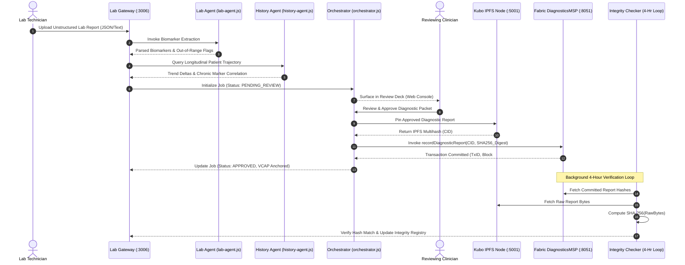
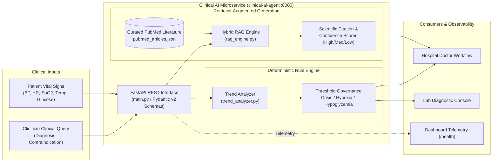
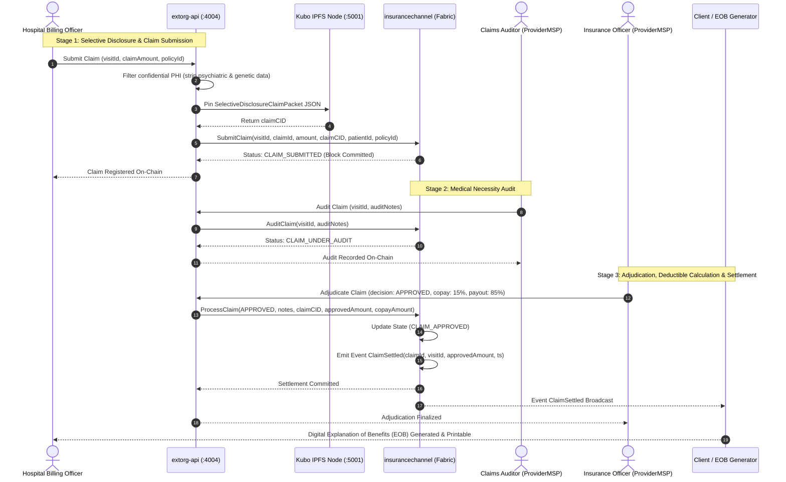

# Current System Architecture

This document describes the complete multi-organization, multi-agent, and blockchain architecture of the Electronic Health Record (EHR) Consortium workspace. It details the runtime topology, communication flows, trust boundaries, and agentic pipelines across all 20 containerized services.

---

## 1. High-Level Consortium Architecture

```mermaid
flowchart TB
  subgraph ClientLayer ["Client & Ingress Layer (Port 80)"]
    Browser["Clinicians, Patients, Admins in Browser"] --> Nginx["Nginx Reverse Proxy & API Gateway (:80)"]
    Nginx --> Hub["Workspace Hub (/)"]
    Nginx --> PatientUI["Hospital Patient Portal (/patient/ → :5174)"]
    Nginx --> DashboardUI["System Dashboard (/dashboard/ → :5176)<br/>Obsidian Glass UI & Block Inspector"]
    Nginx --> LabUI["Lab Console (/lab/ → :3006)"]
    Nginx --> PharmUI["Pharmacy Portals (/pharmacy/*)<br/>Main :5175, Mgr :3001, Emp :3002,<br/>Inv :3003, Patient :3004, Bill :3005"]
    Nginx --> InsuranceUI["Insurance & TPA Claims Deck (/insurance/ → :4004)<br/>Billing, Audit & Adjudication Workspaces"]
    Nginx --> AIAgentUI["Clinical AI Swagger & REST (/ai-agent/ → :8000)"]
    Browser --> HospitalUI["Hospital Staff Portal (:5173)"]
  end

  subgraph MicroservicesLayer ["Microservices & Multi-Agent Layer"]
    HospitalUI --> P0["peer0-api :4001 (Auth / Reception)"]
    HospitalUI --> P1["peer1-api :4002 (Doctor Workflows)"]
    HospitalUI --> P2["peer2-api :4003 (Nurse / Pharmacy / Records)"]
    PatientUI --> PatientAPI["patient-api :4005 (Patient Self-Service)"]
    PharmUI --> PharmAPI["p-backend :3000 (Pharmacy REST API)"]
    InsuranceUI --> ExtOrg["extorg-api :4004<br/>Dual-Channel Gateway & Selective Disclosure Engine"]
    AIAgentUI --> AIAgent["clinical-ai-agent :8000<br/>FastAPI Medical RAG & Trend Analyzer"]
    LabUI --> LabGateway["l-node-gateway :3006"]

    subgraph LabAgenticSubsystem ["Lab Multi-Agent Subsystem"]
      LabGateway --> LabAgent["Lab Agent (lab-agent.js)<br/>Biomarker Parsing & Anomaly Flags"]
      LabGateway --> HistoryAgent["History Agent (history-agent.js)<br/>Longitudinal Trajectory Analysis"]
      LabGateway --> LabOrchestrator["Human-in-the-Loop Orchestrator<br/>orchestrator.js (Review State Machine)"]
      LabGateway --> IntegrityEngine["Ledger Integrity Rechecker<br/>4-Hour Raw-Byte SHA-256 vs Fabric"]
    end
  end

  subgraph BlockchainLayer ["Hyperledger Fabric Consortium (Dual-Channel Architecture)"]
    subgraph ChannelEHR ["Clinical Channel: ehrchannel"]
      FabricHospital[("peer0.hospital :7051<br/>HospitalMSP")]
      FabricDoctor[("peer1.hospital :9051<br/>HospitalMSP")]
      FabricNurse[("peer2.hospital :10051<br/>HospitalMSP")]
      FabricDiag[("peer0.diagnostic :8051<br/>DiagnosticsMSP")]
      FabricExtEHR[("peer0.provider :11051<br/>ProviderMSP")]
    end

    subgraph ChannelINS ["Settlement Channel: insurancechannel (DiagnosticsMSP Excluded)"]
      FabricHospINS[("Hospital Peers<br/>(peer0, peer1, peer2)")]
      FabricProvINS[("peer0.provider :11051<br/>Claims Peer")]
    end

    OrdererNode[("orderer.example.com :7050<br/>Raft CFT Consensus")]

    FabricHospital --- OrdererNode
    FabricDoctor --- OrdererNode
    FabricNurse --- OrdererNode
    FabricDiag --- OrdererNode
    FabricExtEHR --- OrdererNode
    FabricHospINS --- OrdererNode
    FabricProvINS --- OrdererNode
  end

  subgraph StorageLayer ["Decentralized & Persistent Storage"]
    IPFSService["ipfs-service :4006"] --> Kubo[("Kubo IPFS Node<br/>ipfs.ehr.local:5001 / :8090")]
    ExtOrg -->|"Selective Disclosure Packets"| Kubo
    PharmAPI --> Kubo
    PharmAPI <--> PharmStore[("Pharmacy Persistent Store<br/>store.js & JSON State")]
    LabGateway --> Kubo
    IntegrityEngine -.->|Fetch Raw Bytes| Kubo
    IntegrityEngine -.->|Compare On-Chain Digests| FabricDiag
  end

  P0 --> FabricHospital
  P1 --> FabricDoctor
  P2 --> FabricNurse
  PatientAPI --> FabricHospital
  ExtOrg -->|"ehrchannel"| FabricDiag
  ExtOrg -->|"insurancechannel"| FabricProvINS & FabricHospINS
  LabGateway --> FabricDiag

  subgraph ObservabilityLayer ["Group 1 Observatory (Zero-PHI Compliant)"]
    FabricHospital -.->|Committed Block Stream| Collector["Dashboard Block Collector"]
    OrdererNode -.->|Operations /healthz :9443| HealthPoll["HTTP Health Monitor"]
    FabricHospital -.->|Operations /healthz :9444| HealthPoll
    FabricDoctor -.->|Operations /healthz :9445| HealthPoll
    FabricDiag -.->|Operations /healthz :9446| HealthPoll
    FabricExt -.->|Operations /healthz :9447| HealthPoll
    AIAgent -.->|Health /health| HealthPoll
    LabGateway -.->|Telemetry /health| HealthPoll
    PharmAPI -.->|Health /health| HealthPoll
    IPFSService -.->|Health /health| HealthPoll
    PatientAPI -.->|Health /health| HealthPoll

    Collector --> Normalizer["Zero-PHI Event Normalizer"]
    Normalizer --> NDJSONStore[("Append-Only NDJSON Cache<br/>& Checkpoint Store")]
    HealthPoll --> AggregationAPI["REST Aggregation API (:4010)"]
    NDJSONStore --> AggregationAPI
    NDJSONStore --> RealtimeWS["WebSocket /ws & SSE /stream"]
    AggregationAPI --> DashboardUI
    RealtimeWS --> DashboardUI
  end
```

---

## 2. Lab Multi-Agent Orchestration & Verification Flow

The diagnostic workflow incorporates automated intelligence agents with mandatory human clinician governance before committing records to the blockchain ledger and decentralized storage.

---

## 3. Clinical AI & Medical RAG Architecture

The `clinical-ai-agent` microservice provides autonomous medical intelligence, vital signs trend monitoring, and offline PubMed retrieval-augmented generation:

---

## 4. Dual-Channel Insurance & TPA Claims Adjudication Sequence Flow

Claims processing operates across `insurancechannel` — a dedicated, cryptographically isolated channel joining `HospitalMSP` and `ProviderMSP` while strictly excluding `DiagnosticsMSP`. Before submission, sensitive clinical data is redacted into a **Selective Disclosure IPFS Packet**:

---

## 5. Consortium Network & Port Mapping

| Component | Container Name | Host Port | Ingress Route | Technology Stack |
|:---|:---|:---:|:---|:---|
| **Reverse Proxy** | `nginx` | `80` | `/`, `/api/*` | Nginx Alpine Gateway |
| **Hospital Staff Portal** | `hospital-portal` | `5173` | `/hospital/` | Vite, React 18, CareGrid UI |
| **Hospital Patient Portal** | `patient-portal` | `5174` | `/patient/` | Vite, React 18, CareGrid UI |
| **System Dashboard UI** | `h-dashboard-portal` | `5176` | `/dashboard/` | Vite, React 18, Obsidian Glass |
| **Pharmacy Main UI** | `p-frontend` | `5175` | `/pharmacy/` | Vite, React 18 |
| **Pharmacy Sub-Portals** | `p-manager`..`p-billing` | `3001`–`3005` | `/pharmacy/*` | Vite, React 18 (Dedicated Portals) |
| **Pharmacy Patient Portal** | `p-patient` | `3004` | `/pharmacy/patient/` | Vite, React 18, Interactive Self-Gov |
| **Lab Web Console** | `l-node-gateway` | `3006` | `/lab/` | Node.js, Express, Vanilla JS |
| **Insurance & TPA Claims Deck** | `h-extorg-api` | `4004` | `/insurance/`, `/api/insurance/` | Vanilla JS, Glassmorphic CSS3, Fabric Gateway |
| **Clinical AI Agent** | `clinical-ai-agent` | `8000` | `/ai-agent/` | Python 3.11, FastAPI, Pydantic v2 |
| **Hospital Peer0 API** | `h-peer0-api` | `4001` | `/api/hospital/peer0/` | Node.js, Express, Fabric Gateway |
| **Hospital Peer1 API** | `h-peer1-api` | `4002` | `/api/hospital/peer1/` | Node.js, Express, Fabric Gateway |
| **Hospital Peer2 API** | `h-peer2-api` | `4003` | `/api/hospital/peer2/` | Node.js, Express, Fabric Gateway |
| **External Org API** | `h-extorg-api` | `4004` | `/api/hospital/extorg/` | Node.js, Express, Dual-Channel Fabric Gateway |
| **Hospital Patient API** | `h-patient-api` | `4005` | `/api/hospital/patient/` | Node.js, Express, Fabric Gateway |
| **IPFS Bridge Service** | `h-ipfs-service` | `4006` | `/api/hospital/ipfs/` | Node.js, Express, Kubo Client |
| **Dashboard API** | `h-dashboard-api` | `4010` | `/api/dashboard/` | Node.js, NDJSON, WebSocket/SSE |
| **Pharmacy Backend** | `p-backend` | `3000` | `/api/pharmacy/` | Node.js, Express, `store.js` |
| **Kubo IPFS Node** | `ipfs` | `5001`, `8090` | Direct / Internal | Kubo Go-IPFS 0.22 |
| **Fabric Peers** | `peer0.*` | `7051`–`11051` | Fabric gRPC | Hyperledger Fabric 2.5 (Dual Channels) |
| **Fabric Orderer** | `orderer.example.com` | `7050` | Fabric Raft | Hyperledger Fabric 2.5 CFT |

---

## 6. Trust, Privacy & Data Boundaries

1. **Zero-PHI Observability**:
   - The Observatory Dashboard collects blockchain transaction envelopes and node health only.
   - Raw patient identifiers, patient names, diagnoses, prescriptions, and AI narrative are strictly rejected and scrubbed by `Zero-PHI Event Normalizer`.
   - `patientIdHash` is keyed HMAC-SHA256 and only exposed in admin-scoped views.

2. **Decentralized Storage Off-Chain, Cryptographic Anchors On-Chain**:
   - Bulk clinical records, laboratory PDFs, and itemized billing invoices reside on Kubo IPFS.
   - Only cryptographic CIDs (`Qm...`, `bafy...`) and SHA-256 byte digests are anchored immutably in Fabric smart contracts on `ehrchannel` and `insurancechannel`.

3. **Autonomous Scheduled Integrity Rechecking**:
   - The Lab Gateway's background integrity checker guarantees that raw records stored in IPFS have not been altered or tampered with by verifying `SHA256(RawBytes) == OnChainDigest` every 4 hours.

4. **Multi-Organization Consensus & Role Isolation**:
   - `HospitalMSP`: Governs patient registration, visits, consultations, and inpatient prescriptions.
   - `DiagnosticsMSP`: Governs diagnostic orders, lab biomarker analysis, and human approval anchoring.
   - `ProviderMSP`: Governs claims settlement, insurance coverage, and cross-organization audits.

5. **Dual-Channel Cryptographic Partitioning & Selective Disclosure**:
   - `insurancechannel` isolates claims negotiation and policy payouts between `HospitalMSP` and `ProviderMSP`, strictly excluding `DiagnosticsMSP`.
   - Off-chain claim packets enforce **Selective Disclosure** (HIPAA and DPDP Act 2023 compliant): psychotherapy notes, genetic markers, and unauthorized clinical narratives are automatically filtered prior to IPFS pinning.
