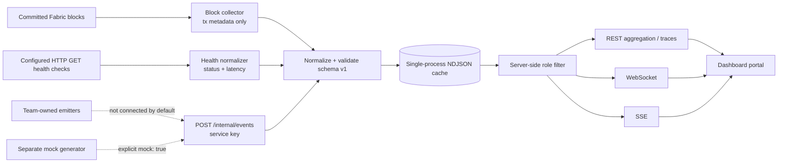

# Dashboard event architecture

The dashboard is optional and read-only against Fabric. The pipeline receives committed block metadata, configured HTTP health transitions, and authenticated producer envelopes. It validates and stores only the agreed non-PHI envelope before role-filtered REST/realtime delivery.

## Sources

1. The Fabric collector consumes committed block events through `@hyperledger/fabric-gateway@1.4.0`. It extracts transaction ID, channel, chaincode/function, creator MSP, validation code, block number, and transaction timestamp. It never copies invocation arguments, read/write sets, or transaction response values.
2. The health poller sends bounded HTTP GET requests to targets configured in `dashboard-api/config/topology.json`. It retains response status and measured latency and discards response bodies. Status transitions use configured failure thresholds.
3. Team-owned producers POST event envelopes to `/internal/events` with `X-Dashboard-Service-Key`. The route is disabled until a service key is configured and is intentionally not routed through Nginx.
4. The mock generator is a separate CLI. Every generated event has `mock: true`; the API accepts it only when `DASHBOARD_ALLOW_MOCK=true`.

## Envelope and zero-PHI boundary

Schema version 1 requires `schemaVersion`, `eventId`, `eventType`, `timestamp`, `source`, `org`, `severity`, and `payload`. Optional fields include `peerId`, `txId`, `blockNumber`, `correlationId`, `channel`, `mock`, and `unregistered`. The validator allow-lists fields by event type and rejects raw patient references, names, clinical values, AI narrative, and unsupported nested content. A keyed `patientIdHash` is accepted only for registered event types that declare it; non-admin views omit it.

## Fabric checkpoint and retries

On first start, the collector queries channel height and requests the configured recent backfill window. It checkpoints completed blocks with an atomic file replacement. On restart it resumes from checkpoint + 1. Missing observer certificates, connection failures, and interrupted streams report `NOT_CONNECTED` and retry. The API and HTTP health poller continue independently. The dashboard does not enroll identities or use another service's wallet or `.env`.

## Ownership and limitations

AI, history, governance, FHIR, Security/VCAP, gateway, lab, and pharmacy event producers remain `TODO(dependency: <team>)` until supplied by their owning teams. `history-agent` is a logical registry entry only. The local event cache is not a tamper-evident or authoritative compliance audit record. No chaincode or gateway patch is applied by the dashboard module.
