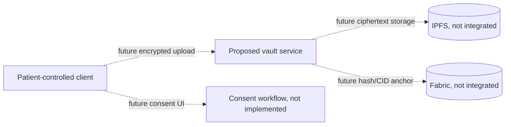

# Digilocker — proposed module only

Digilocker is inventoried as a proposed patient-controlled document vault. This folder does not contain a runnable frontend, backend, or chaincode implementation. It is not started by root `./start.sh`, and no encryption, patient key custody, IPFS pinning, ledger anchoring, or consent workflow should be described as implemented here.

The diagram below shows a design direction only. It is not a deployed data path:

## Work required before implementation

- Agree encryption, key generation, recovery, revocation, and device-loss behavior with the Security and EHR teams.
- Define what is stored off-chain and which metadata may be anchored on-chain.
- Implement authenticated APIs and UI from approved interfaces.
- Validate zero-PHI event and audit requirements before any dashboard producer is connected.

Until then, use the hospital patient portal for existing patient workflows and do not treat this proposal as a document repository.
