# Hospital EHR Chaincode — Smart Contract Package
## Hyperledger Fabric Domain Contracts Package across Dual Channels (`ehrchannel` & `insurancechannel`)

This directory contains the production Hyperledger Fabric smart contract package for the Electronic Health Record (EHR) Consortium, deployed across dual channels:
- `ehrchannel`: Clinical, laboratory, and pharmacy consortium transactions (package version 3.1).
- `insurancechannel`: Confidential insurance claims adjudication, co-pay calculation, and settlement transactions between `HospitalMSP` and `ProviderMSP` (package version 1.1, Sequence 2).

The package exports **thirteen distinct smart contracts** from `index.js`, implementing domain-separated access controls, clinical governance, multi-actor laboratory verification, cross-organizational interoperability, and automated insurance policy adjudication.

---

## 🏛️ Smart Contract Architecture

```mermaid
flowchart TB
  subgraph ConsortiumAPIs ["Consortium Microservices"]
    HospitalAPI["Hospital APIs (:4001–:4003)"]
    PatientAPI["Patient API (:4005)"]
    ExtOrgAPI["ExtOrg API & Claims Deck (:4004)"]
    LabGateway["Lab Node Gateway (:3006)"]
    PharmAPI["Pharmacy Backend (:3000)"]
    DigiLockerAPI["DigiLocker Service (:4007)"]
  end

  subgraph FabricLayer ["Hyperledger Fabric Network (Dual Channels)"]
    subgraph ChannelEHR ["Clinical Channel: ehrchannel (Hospital + Diagnostics + Provider)"]
      RouterEHR["EHR Chaincode Router (ehr:3.1)"]
      PatientC["PatientContract<br/>Registration, demographic profile, DID anchor"]
      VisitC["VisitContract<br/>Encounter lifecycle, queue assignment, discharge"]
      ClinicalC["ClinicalContract<br/>Consultation notes, diagnoses, prescriptions"]
      ForwardC["ForwardContract<br/>Inter-department patient transfer & handoffs"]
      LabC["LabContract<br/>Lab orders, biomarker results, approval anchoring"]
      EhrC["EhrContract<br/>Patient EHR metadata & immutable IPFS CIDs"]
      AccessC["AccessContract<br/>Consent grants, revocations, and access logs"]
      FhirC["FhirContract<br/>HL7 FHIR R4 resource anchors"]
      DigiLockerC["DigiLockerContract<br/>Authentic clinical PDF anchoring"]
      DidC["DidContract<br/>W3C DID resolution & key bindings"]
      CodeC["CodeContract<br/>ICD-10 clinical coding rules"]
      StatsC["StatsContract<br/>Ledger telemetry & block metrics"]
    end

    subgraph ChannelINS ["Settlement Channel: insurancechannel (Hospital + Provider)"]
      RouterINS["Insurance Chaincode Router (ehr:1.1)"]
      ClaimsC["ClaimsContract<br/>Selective disclosure, policy adjudication, co-pay split, ClaimSettled event"]
    end
  end

  HospitalAPI --> RouterEHR
  PatientAPI --> RouterEHR
  ExtOrgAPI -->|"Diagnostics Routes"| RouterEHR
  ExtOrgAPI -->|"Claims & Adjudication Routes"| RouterINS
  LabGateway --> RouterEHR
  PharmAPI --> RouterEHR
  DigiLockerAPI --> RouterEHR

  RouterEHR --> PatientC & VisitC & ClinicalC & ForwardC & LabC
  RouterEHR --> EhrC & AccessC & FhirC & DigiLockerC
  RouterEHR --> DidC & CodeC & StatsC

  RouterINS --> ClaimsC
```



---

## 📜 Contract Reference & Responsibilities

| Contract | Source File | Key Transaction Functions | Scope / Purpose |
|:---|:---|:---|:---|
| **`PatientContract`** | `lib/patientContract.js` | `registerPatient`, `queryPatient`, `updatePatientDemographics`, `getPatientHistory` | Demographics, DID binding (`did:ehr:<hash>`), root record |
| **`VisitContract`** | `lib/visitContract.js` | `createVisit`, `assignDoctor`, `updateDiagnosisNotes`, `updateDiseaseCode`, `finalizeVisit` | Encounter lifecycle state machine & queue routing |
| **`ForwardContract`** | `lib/forwardContract.js` | `forwardToDoctor`, `forwardToNurse`, `forwardToLab`, `forwardToPharmacy` | Clinical transfers between departments |
| **`ClinicalContract`** | `lib/clinicalContract.js` | `recordVitals`, `addConsultationNote`, `createPrescription`, `dispenseMedication` | Vital signs, treatment plans, and pharmacy dispensation |
| **`LabContract`** | `lib/labContract.js` | `createLabRequest`, `acknowledgeLabRequest`, `recordDiagnosticReport`, `approveLabReport` | Diagnostic test ordering, analyzer ingestion, supervisor verification |
| **`ClaimsContract`** | `lib/claimsContract.js` | `SubmitClaim`, `AuditClaim`, `ProcessClaim`, `GetClaim`, `GetAllClaims`, event `ClaimSettled` | Insurance claim filing, selective disclosure IPFS packet linking, policy adjudication, deductible/co-pay calculation, automated settlement |
| **`EhrContract`** | `lib/ehrContract.js` | `anchorEhrCid`, `getEhrHistory`, `verifyRecordMultihash` | Immutable IPFS CID pointers and hash verification |
| **`AccessContract`** | `lib/accessContract.js` | `grantConsent`, `revokeConsent`, `checkAccess`, `emergencyBreakGlass` | Patient-governed consent and break-glass audit |
| **`FhirContract`** | `lib/fhirContract.js` | `anchorFhirResource`, `getFhirResource`, `validateFhirSchema` | HL7 FHIR R4 standard healthcare resource anchors |
| **`DigiLockerContract`** | `lib/digilockerContract.js` | `anchorDocument`, `verifyDocumentHash`, `revokeDocument` | Authentic government clinical PDF proof anchoring |
| **`DidContract`** | `lib/didContract.js` | `createDID`, `resolveDID`, `updatePublicKey`, `deactivateDID` | W3C DID document registry and public key bindings |
| **`CodeContract`** | `lib/codeContract.js` | `validateICD10Code`, `recordCodeOverride`, `lookupDiseaseByCode` | ICD-10 medical coding validation & override audit |
| **`StatsContract`** | `lib/statsContract.js` | `getLedgerOverview`, `getTransactionVolume`, `getChannelBlockHeight` | Real-time observatory metrics and ledger telemetry |

---

## 🔒 Data Privacy & State Storage

- **World State (GoLevelDB):** Records are indexed by structured keys (e.g. `PATIENT_PAT-001`, `VISIT_VIS-2026-001`, `RECORD~<hash>~<id>`).
- **Zero-PHI Compliance:** Production deployments require patient identifiers to be pseudonymized and all bulky medical payloads (diagnostic scans, itemized invoices) pinned to IPFS, storing only the cryptographic CID multihash on-chain.
- **Multi-MSP Endorsement:** Transactions involving cross-organization workflows (such as Lab approvals and Pharmacy billing) enforce endorsement policies spanning `HospitalMSP`, `DiagnosticsMSP`, and `ProviderMSP`.

---

## 🚀 Deployment & Upgrades

Chaincode deployment is automatically managed by the universal startup orchestrator:
```bash
./start.sh
```

When upgrading chaincode manually:
```bash
cd orgs/hospital/EHR_hospitalOrg-main/ehr-network
bash scripts/deployChaincode.sh --channel ehrchannel --chaincode-name ehr \
  --chaincode-path ../ehr-chaincode-v3 --version 3.1 --sequence <sequence_number>
```

---
*Maintained by **Himanshu (24MCF1R16)** — Master of Computer Applications, NIT Warangal.*  
*Repository: [https://github.com/devbyhimans/Electronic_Health_Record_Blockchain.git](https://github.com/devbyhimans/Electronic_Health_Record_Blockchain.git)*
