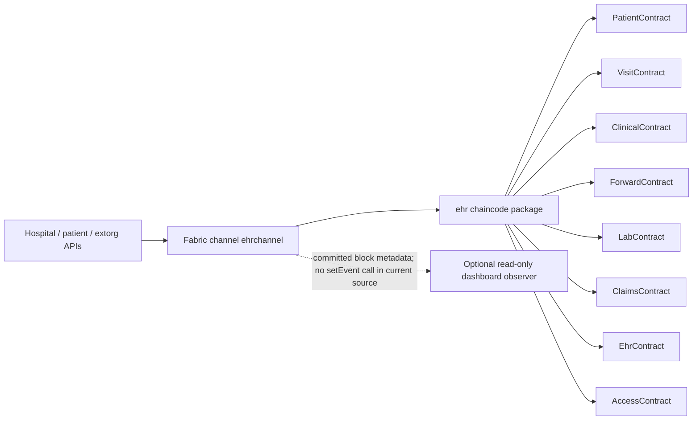

# Hospital EHR chaincode — source overview

The source package exports eight Fabric contracts from `index.js`: `PatientContract`, `VisitContract`, `ForwardContract`, `ClinicalContract`, `LabContract`, `ClaimsContract`, `EhrContract`, and `AccessContract`. The implementation in `lib/` is authoritative for available transaction names and behavior; do not treat an academic specification or an earlier deployment note as proof that a function is committed to a live channel.

## Current data and privacy note

The chaincode stores personal and clinical fields in ledger state. For example, patient registration accepts patient identifiers, names, demographic/contact details, and the visit contract stores visit workflow data. Do not use real patient information in this academic/demo network. This source does not by itself establish FHIR conformance, encryption at rest, private-data-collection coverage, legal compliance, or production suitability.

The dashboard collector derives metadata from committed blocks and intentionally does not depend on `stub.setEvent()`. A proposal to add an event helper is only a draft for team review; it is not part of this chaincode unless a future coordinated source change is made and deployed.

## Contract areas

| Contract | Source file | Main area (verify transactions in source) |
|---|---|---|
| `PatientContract` | `lib/patientContract.js` | Registration, patient queries, patient history, patient EHR CID links. |
| `VisitContract` | `lib/visitContract.js` | Visit lifecycle, assignments, finalization, discharge, visit history. |
| `ForwardContract` | `lib/forwardContract.js` | Forwarding visits between nurse, doctor, and lab workflows. |
| `ClinicalContract` | `lib/clinicalContract.js` | Diagnosis notes, vitals, care notes, prescriptions, dispensing. |
| `LabContract` | `lib/labContract.js` | Lab request acknowledgements, results, and approvals. |
| `ClaimsContract` | `lib/claimsContract.js` | Claim submission, audit, and processing. |
| `EhrContract` | `lib/ehrContract.js` | EHR CID state and history. |
| `AccessContract` | `lib/accessContract.js` | Consent grants, revocation, access requests, and audit helpers. |

To inspect the current contract exports, read `index.js` and the corresponding `lib/` file. Root `./start.sh` starts the existing Fabric deployment but does not enroll identities, reset a channel, or deploy chaincode. See the [root setup guide](../../../../README.md).
