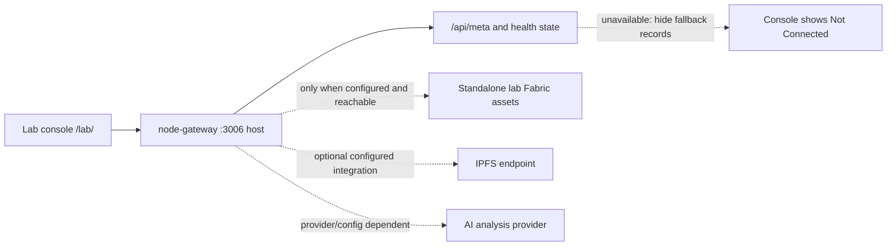

# Lab gateway and console

This module contains a Node/Express gateway with a static browser console plus separate standalone Fabric network assets. Root `./start.sh` starts only the gateway container (`l-node-gateway`) alongside the root network; it does not run this folder's distributed lab network scripts.

## Root workspace behavior

| Service | Host port | Route |
|---|---:|---|
| Lab gateway and static console | `3006` | [http://localhost/lab/](http://localhost/lab/) through Nginx |
| Gateway health | `3006` | `GET /api/health` |
| Gateway metadata | `3006` | `GET /api/meta` |
| Lab result routes | `3006` | `/api/records`, `/api/records/:resultId`, `/api/ai/analyze`, `/api/ipfs/*` and related routes |

The console does not claim live peer data when `/api/meta` cannot establish a connection; it hides fallback records in that state. API routes in the gateway source do not establish that the root Fabric network, AI provider, or IPFS endpoint is connected. Check the UI's current status and actual API response before describing results as live.

## Standalone network materials

This folder also contains scripts/configuration for a separate multi-machine lab network. These settings and network scripts are not automatically run by the root launcher and may describe an earlier deployment. Confirm the intended Fabric channel, peer topology, and credentials with the Lab and Blockchain teams before using them.

For the integrated local workspace, run `./start.sh` from the repository root. It preserves existing identities and ledger state and does not deploy this standalone lab network. See the root [README](../../../README.md) and [architecture](../../../docs/architecture.md).
