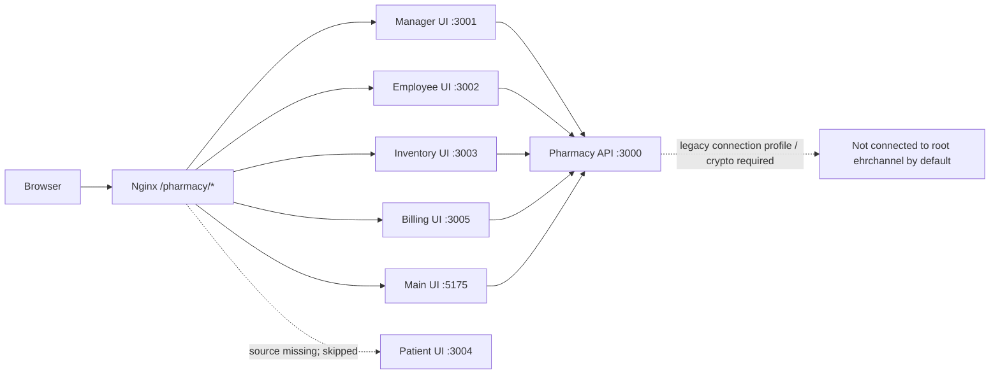

# Pharmacy applications

The pharmacy folder contains one Express API and several separately maintained Vite applications. They are not consolidated into the hospital portal and are not evidence of a connected pharmacy Fabric organization.

## Current local applications

| App/service | Port | Root route | Status in root workspace |
|---|---:|---|---|
| Backend API | `3000` | `/api/pharmacy/` through Nginx | Starts as `p-backend`; its ledger/IPFS dependencies may be unavailable. |
| Manager UI | `3001` | `/pharmacy/manager/` | Starts from its own source. |
| Employee UI | `3002` | `/pharmacy/employee/` | Starts from its own source. |
| Inventory UI | `3003` | `/pharmacy/inventory/` | Starts from its own source. |
| Patient UI | `3004` | `/pharmacy/patient/` | Not started: `app/patient/src` is missing in this checkout. |
| Billing UI | `3005` | `/pharmacy/billing/` | Starts from its own source. |
| Main frontend | `5175` | `/pharmacy/` | Starts from its own source. |



The Vite apps proxy `/api/pharmacy` to `p-backend` in Compose. The UI avoids substituting fabricated patient or stock data when APIs fail and disables writes when connectivity is not verified. A successful API health response does not prove a Fabric transaction succeeded.

## Current integration limitation

The existing pharmacy backend defaults to `mychannel` and its connection profile references a legacy `Org1MSP` setup. The root Fabric topology uses `ehrchannel` with `HospitalMSP`, `DiagnosticsMSP`, and `ProviderMSP`. The current chaincode source does not expose the pharmacy inventory function set expected by this backend. Do not claim ledger-backed pharmacy functionality until the Pharmacy and Blockchain teams provide a matching profile, wallet/crypto configuration, deployed contract functions, and verified integration.

Root workspace startup:

```bash
./start.sh
```

The root startup starts the API and all six separate portal containers. The patient portal is a status-only shell: it does not query patient records because the API does not provide verified patient authentication or patient-scoped sessions. The separate `deploy.sh` and Swarm materials are legacy/standalone workflows and are not invoked by root startup. Do not run them against the shared Fabric network without the owning teams' agreement.
